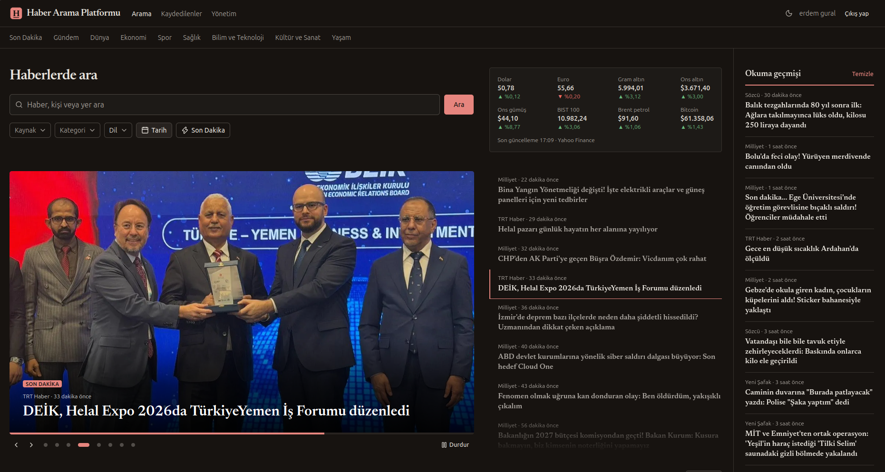
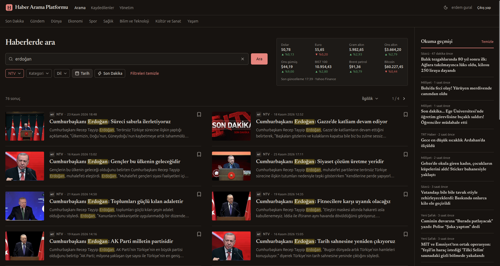
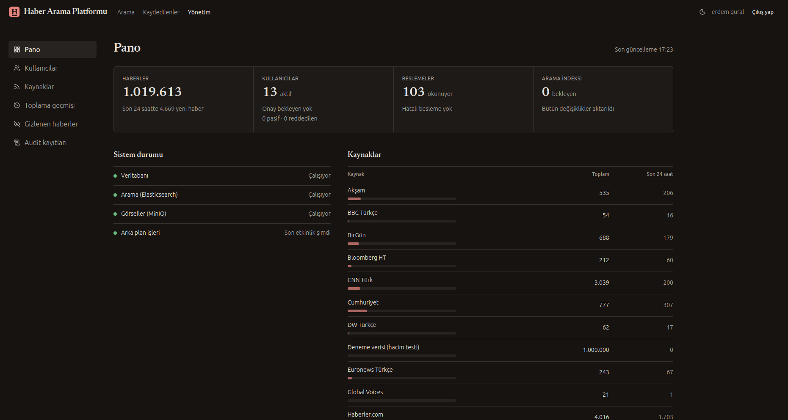

# Haber Arama Platformu

Farklı haber kaynaklarından haberleri toplayan, tek yerde birleştirerek aranabilir hale getiren ve sonuçları görselleriyle birlikte, özgün habere bağlantı vererek gösteren bir web uygulaması.



| Arama sonuçları | Haber detayı | Yönetim paneli |
|---|---|---|
|  |  |  |

## Özellikler

**Haber toplama**

- 21 kaynaktan, 103 beslemeden düzenli toplama. Türkçe: TRT Haber, NTV, CNN Türk, Hürriyet, Milliyet, Sabah, Sözcü, Star, Yeni Şafak, Akşam, BirGün, Cumhuriyet, Karar, BBC Türkçe, DW Türkçe, Euronews Türkçe, Sputnik Türkiye, Bloomberg HT, Haberler.com. İngilizce: The New York Times (Top Stories API), Global Voices.
- RSS ve Atom beslemeleri ile NYT Top Stories API'si. NYT için API anahtarı gerekir; anahtar verilmezse diğer kaynaklar etkilenmez.
- Kaynak başına istek aralığı ve koşullu istek (`ETag`): kaynak sitelere gereksiz yük binmez.
- Aynı haber ikinci kez kaydedilmez; başka bir beslemede gelirse yalnızca eksik kategorisi eklenir.
- Okunamayan besleme 1, 5, 15 ve 15 dakika sonra yeniden denenir; 5. hatada kendiliğinden kapanır ve audit kaydına yazılır.
- Görseller indirilir, WebP biçimine çevrilip küçültülür ve imzalı, süreli adreslerle sunulur.

**Arama**

- Türkçe ve İngilizce tam metin arama. Türkçe karaktersiz yazılan aramalar da eşleşir ("cumhurbaskani"); tırnak içindeki ifade birebir aranır.
- Kaynak, kategori, dil ve tarih aralığı filtreleri; son 6 saatin haberleri için Son Dakika.
- İlgililiğe veya tarihe göre sıralama, eşleşen kelimelerin vurgulanması, sayfalama.

**Kullanıcı ekranları**

- Ana sayfa: Son Dakika'nın görselli haberlerinden (yetmezse Gündem'den) kendiliğinden dönen manşet, kategorilere göre son haberler ve sayfayı yenilemeden güncelleyen "Yenile" düğmesi.
- Piyasa verileri: dolar, euro, gram altın, ons altın, ons gümüş, BIST 100, Brent petrol ve Bitcoin; işçi 15 dakikada bir Yahoo Finance'ten günceller.
- Haber detayı: temizlenmiş tam metin, görseller, okuma süresi, yazı boyutu ayarı, paylaşma, ilgili haberler, kaynağın atfı ve özgün habere bağlantı.
- Kaydedilen haberler, okuma geçmişi (tarayıcıda saklanır), açık ve koyu tema.

**Kimlik ve yetki**

- Kayıt ve giriş Keycloak ile. Keycloak yalnızca kullanıcının kim olduğunu söyler; ne yapabileceğine API her istekte veritabanındaki `users` tablosuna bakarak karar verir.
- Yeni kullanıcı yönetici onayını bekler. Durumlar: onay bekliyor, aktif, pasif, reddedildi. Pasif yapılan kullanıcının erişimi bir sonraki isteğinde kesilir.
- Yapılandırmadaki e-posta adresiyle kaydolan ilk kullanıcı yönetici olur.

**Yönetim paneli**

- Pano: sistemin durumu (veritabanı, arama, görseller, arka plan işleri) ve temel istatistikler.
- Kullanıcılar: onaylama, reddetme, rol ve durum değişikliği.
- Kaynaklar ve beslemeler: ekleme, düzenleme, açma-kapama, elle toplama başlatma, kaynağın içeriğini silme.
- Toplama geçmişi, gizlenen haberler, audit kayıtlarında arama ve CSV olarak indirme.

**Veri ve işletim**

- Audit log: kimin, ne zaman, neyi yaptığı. Kayıtlar veritabanı yetkileri ve tetikleyicilerle korunur; değiştirilemez ve silinemez.
- Veri yaşam döngüsü: haberler yaşına göre işaretlenir: 30 günden yeniyse HOT, 1 yıla kadar WARM, daha eskiyse COLD. Arama indeksi aylara bölünür; eski aylar Elasticsearch'ün yaşam döngüsü politikasıyla kendiliğinden birleştirilir ve önceliği düşürülür. Haberler silinmez.
- Ölçüm ve uyarı: Prometheus API'nin, işçinin ve Kubernetes'in ölçümlerini toplar; disk doluluğu, bozulan kaynak, yüksek hata oranı ve yetkisiz istek artışı için e-postayla uyarı gönderilir.
- Yedekleme: PostgreSQL ve Elasticsearch her gece MinIO'ya yedeklenir, yedekler 7 gün saklanır.

## Mimari

```
Tarayıcı ──► Traefik (Gateway API) ──┬──► Frontend (React, nginx)         haber.localhost/
                                     ├──► API (Spring Boot)               haber.localhost/api/
                                     └──► Keycloak                        haber.localhost/auth/

API ──► PostgreSQL (asıl kayıt) · Elasticsearch (arama, okuma) · MinIO (görseller, okuma)
İşçi (Python) ──► haber kaynakları, Yahoo Finance · PostgreSQL · Elasticsearch (yazma) · MinIO (yazma)
```

- **API** (Java 25, Spring Boot 4.1): Kullanıcı ve yönetici isteklerini karşılar. Modüler monolit; modüller `identity`, `ingestion`, `search`, `library`, `admin`, `audit` ve `market`. Modül sınırları Spring Modulith ile denetlenir.
- **İşçi** (Python 3.14, asyncio): Bütün arka plan işleri yan yana çalışır: haber toplama, arama indeksine aktarım (outbox), görsel indirme, kaynak içeriğinin silinmesi, bakım (yaşam döngüsü ve eski kayıtların temizliği), ölçümlerin güncellenmesi ve piyasa verileri.
- **İki uygulama doğrudan konuşmaz**, yalnızca veri depoları üzerinden haberleşir.
- **Frontend** (React, TypeScript, Vite, shadcn/ui, TanStack Query): Derlenmiş dosyalar nginx konteynerinden sunulur.
- **Veri:** PostgreSQL meta veriyi ve kullanıcıları, Elasticsearch haber metinlerini ve arama indeksini, MinIO görselleri ve yedekleri tutar.
- Hepsi yerel bir Kubernetes kümesinde (k3d) çalışır.

Ayrıntılar: `docs/04-mimari.md` ve `docs/adr/`.

## Kurulum

Boş bir Ubuntu bilgisayarda sıfırdan kurulum (araçların kurulumu dahil): **[`deploy/README.md`](deploy/README.md)**.

Kısaca: Docker, kubectl, Helm ve k3d kurulur; küme oluşturulur, altyapı bileşenleri kurulur, üç uygulama betiklerle derlenip dağıtılır ve uygulama `http://haber.localhost/` adresinden açılır. Bilgisayarda Java, Node.js veya Python gerekmez; imajlar Docker'ın içinde derlenir.

### Önerilen donanım

| | En az | Önerilen |
|---|---|---|
| İşlemci | 4 çekirdek | 8 çekirdek |
| Bellek (RAM) | 8 GB | 16 GB |
| Boş disk | 25 GB | 40 GB |

Küme olağan çalışmada yaklaşık 4 GB bellek kullanır. İşlemciyi en çok arama kullanır: performans testinde 1 milyon haberle ve 50 eş zamanlı kullanıcıyla Elasticsearch ortalama 3,5, en çok 4,5 çekirdek kullandı.

Bileşenlerin Kubernetes'teki kaynak tanımları:

| Bileşen | Bellek isteği / sınırı | CPU isteği |
|---|---|---|
| Elasticsearch | 2 Gi / 2 Gi | 500m |
| Keycloak | 768 Mi / 1 Gi | 250m |
| PostgreSQL | 512 Mi / 1 Gi | 250m |
| MinIO | 512 Mi / 1 Gi | 250m |
| API | 512 Mi / 768 Mi | 250m |
| İşçi | 96 Mi / 1 Gi | 50m |
| Mailpit | 64 Mi / 128 Mi | 50m |
| Frontend | 32 Mi / 64 Mi | 25m |

CPU'da yalnızca istek tanımlıdır: bileşenler boştaki işlemciyi kullanabilir, Kubernetes istekleri pod'ları yerleştirirken hesaba katar.

## Depo düzeni

| Klasör | İçerik |
|---|---|
| `backend/` | Spring Boot API |
| `worker/` | Python işçisi (`news_worker`) |
| `frontend/` | React uygulaması |
| `db/migrations/` | Veritabanı geçiş betikleri (Flyway, `V1` – `V23`) |
| `deploy/` | k3d kümesi ve Kubernetes dosyaları (Kustomize, Helm ayarları) |
| `scripts/dev/` | Derleme, dağıtım ve bakım betikleri |
| `tests/performance/` | Performans testleri (k6 senaryosu, hazırlık ve özet betikleri) |
| `docs/` | Gereksinimler, mimari, veri modeli, API sözleşmesi, ekran akışları, kararlar (ADR), test raporları |

## Testler

Testleri bilgisayarda çalıştırmak için ilgili araçlar ve Docker gerekir (entegrasyon testleri gerçek PostgreSQL, Elasticsearch ve MinIO'yu Testcontainers ile Docker'da başlatır). CI aynı komutları her gönderimde çalıştırır (`.github/workflows/`).

| Uygulama | Gerekenler | Komut |
|---|---|---|
| API | JDK 25, Docker | `cd backend && ./mvnw verify` |
| İşçi | uv 0.13.6 (Python 3.14'ü kendisi kurar), Docker | `cd worker && uv sync --locked && uv run pytest` |
| Frontend | Node.js 26.12.1 | `cd frontend && npm ci && npm test` |

Kod stili ve tür denetimleri: API'de `verify` içinde (Spotless); işçide `uv run ruff check .` ve `uv run mypy`; frontend'de `npm run lint` ve `npm run format:check`.

CI ayrıca commit mesajlarını (Conventional Commits), gizli bilgi sızıntısını (gitleaks), bağımlılık ve imaj açıklarını (Trivy) ve uyarı kurallarını (promtool) denetler.

Test raporları: `docs/test-raporlari/`.

## Dokümanlar

| Dosya | İçerik |
|---|---|
| `docs/sartname.pdf` | Şartname |
| `docs/01-kapsam.md` | Kimin için, hangi sorun, kapsam dışı |
| `docs/arastirma/` | Haber kaynakları araştırması ve kullanım şartları |
| `docs/02-gereksinimler.md` | Fonksiyonel ve fonksiyonel olmayan gereksinimler |
| `docs/03-riskler.md` | Risk kaydı |
| `docs/04-mimari.md` | Bileşenler, modüller, akışlar |
| `docs/05-veri-modeli.md` | PostgreSQL tabloları, Elasticsearch, MinIO, veritabanı kullanıcıları |
| `docs/06-api-sozlesmesi.md` | `/api/v1/` uç noktaları ve hata kodları |
| `docs/07-ekran-akislari.md` | Ekranlar ve uçtan uca senaryolar |
| `docs/08-test-stratejisi.md` | Test türleri ve hedefleri |
| `docs/09-is-plani.md` | İş kalemleri ve haftalara dağılım |
| `docs/10-kodlama-standartlari.md` | Kodlama kuralları |
| `docs/adr/` | Mimari kararlar ve gerekçeleri |
| `docs/test-raporlari/` | Test raporları |
| `docs/ilerleme/` | Haftalık ilerleme notları |
