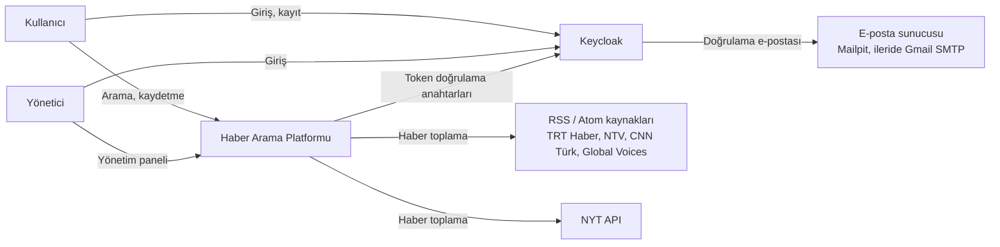
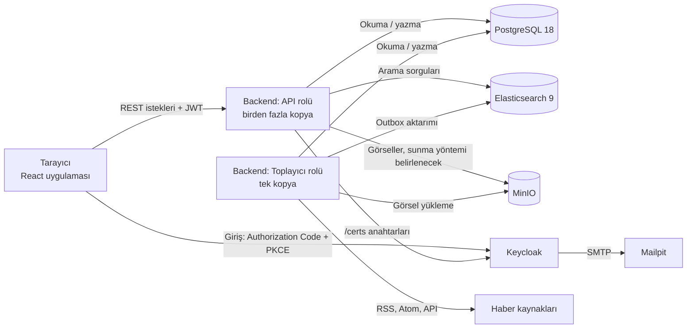
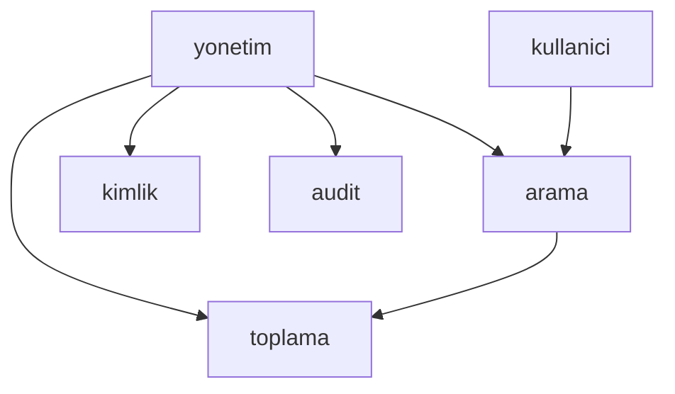
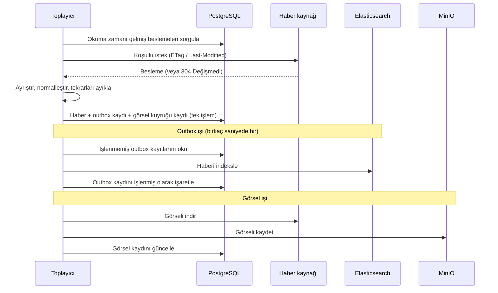
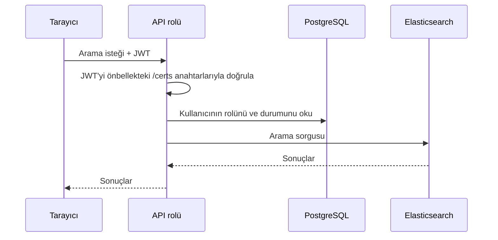
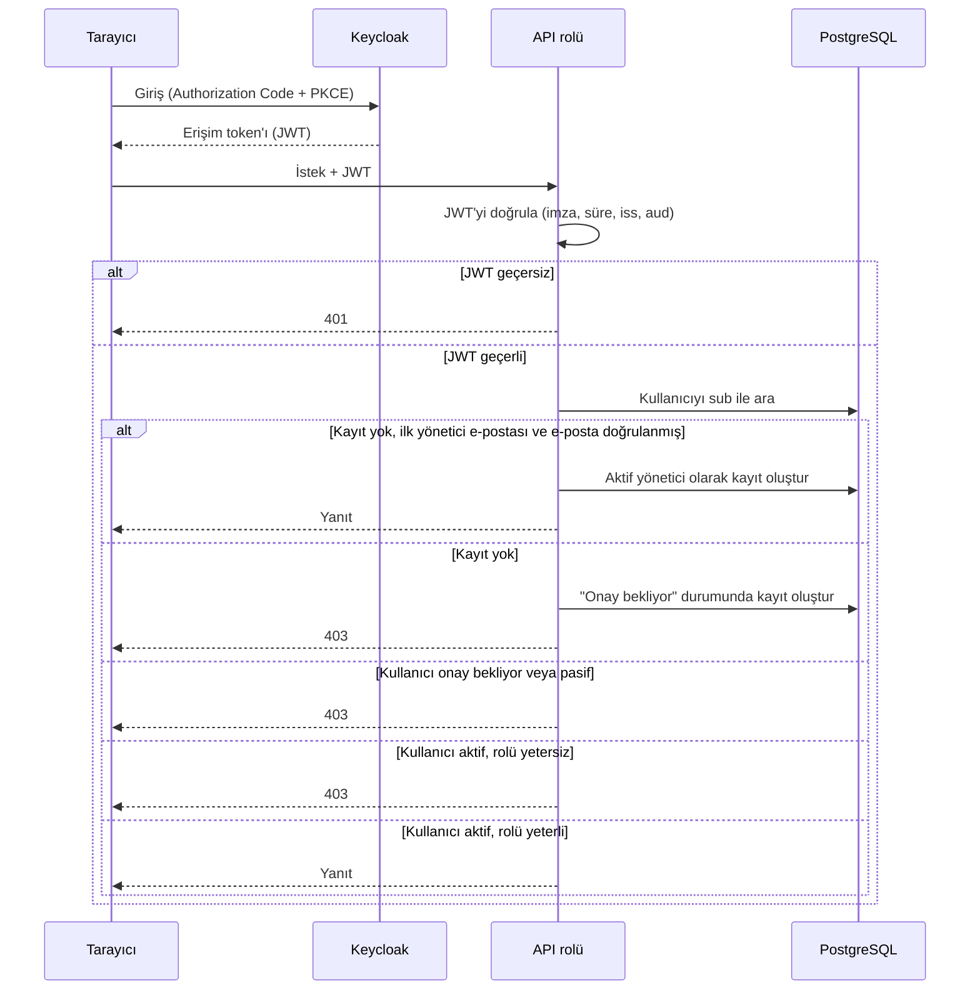
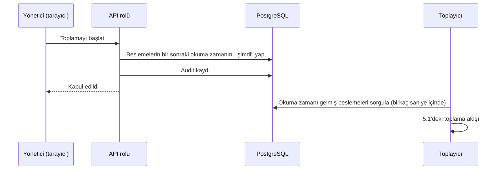
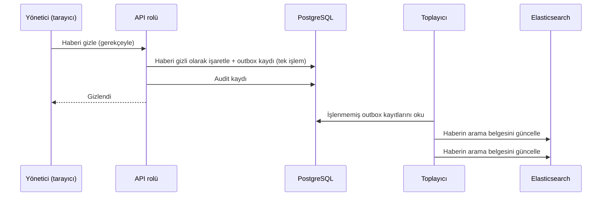

# Mimari

## 1. Amaç

Bu doküman, uygulamanın genel yapısını ve parçaların birbirleriyle nasıl çalıştığını anlatır. Yapı, C4 modelindeki gibi dıştan içe doğru üç düzeyde ele alınır: sistem bağlamı, bileşenler ve modüller.

Kararların gerekçeleri ilgili ADR'lerdedir:

| Konu | ADR |
|---|---|
| Depo yapısı | ADR-0001 |
| Haber kaynakları | ADR-0003, ADR-0004, ADR-0006, ADR-0009 |
| Mimari stil ve çalışma rolleri | ADR-0005 |
| Java, Spring Boot ve derleme aracı | ADR-0007 |
| Görsellerin depolanması | ADR-0010 |
| Veri depoları ve yaşam döngüsü | ADR-0011 |
| PostgreSQL ile Elasticsearch'ün eşitlenmesi | ADR-0012 |
| Veri toplama | ADR-0013 |
| Kimlik ve yetki | ADR-0014 |

## 2. Sistem Bağlamı

| Aktör / Sistem | Rolü |
|---|---|
| Kullanıcı | Haberlerde arama yapar, haberleri görüntüler ve kaydeder. |
| Yönetici | Kullanıcıları, kaynakları ve sistemi yönetir. |
| Keycloak | Kullanıcının kimliğini doğrular ve JWT üretir; uygulama rolü tutmaz. |
| RSS / Atom kaynakları | Haberlerin beslemeler üzerinden toplandığı kaynaklar. |
| NYT API | Haberlerin API üzerinden toplandığı kaynak. |
| E-posta sunucusu | Keycloak'ın kayıt doğrulama e-postalarını gönderdiği sunucu. |

## 3. Bileşenler

| Bileşen | Görevi | Kopya sayısı | ADR |
|---|---|---|---|
| React uygulaması | Kullanıcı arayüzü ve yönetim paneli | — | — |
| API rolü | Kullanıcı ve yönetici isteklerini karşılar | Birden fazla | ADR-0005 |
| Toplayıcı rolü | Zamanlanmış işleri yürütür: haber toplama, outbox aktarımı, görsel indirme, yaşam döngüsü güncellemesi | Tek | ADR-0005, ADR-0013 |
| PostgreSQL 18 | Asıl kayıt | — | ADR-0011 |
| Elasticsearch 9 | Türetilmiş arama indeksi | — | ADR-0011, ADR-0012 |
| MinIO | Görsel dosyaları | — | ADR-0010 |
| Keycloak | Kimlik doğrulama | — | ADR-0014 |
| Mailpit | Geliştirme ortamında e-posta yakalama | — | ADR-0014 |

API rolü ve toplayıcı rolü aynı kod tabanından, aynı derleme çıktısından çalışır; hangi rolde başlatılacakları yapılandırmayla belirlenir (ADR-0005). Görsellerin tarayıcıya hangi yolla sunulacağı henüz belirlenmemiştir (bkz. 7. bölüm).

## 4. Modüller

Backend, iş alanlarına göre altı modülden oluşur (ADR-0005). Bir modül başka bir modülün iç sınıflarına doğrudan erişmez; yalnızca o modülün dışa açtığı arayüzleri kullanır.

| Modül | Sorumluluk | Çalıştığı rol |
|---|---|---|
| kimlik | Kullanıcı tablosu, kullanıcı durumları, token'daki kimliğin kullanıcıyla eşleştirilmesi, yetki kontrolü | API |
| toplama | Kaynaklar, beslemeler, zamanlama, RSS/Atom/API okuyucuları, normalleştirme, kategori eşlemesi, tekrar kontrolü, görsel kuyruğu | Toplayıcı; kaynak yönetimi uç noktaları API'de |
| arama | Elasticsearch indeks yapısı, arama sorguları, outbox aktarımı, tam yeniden indeksleme, kaynaklar arası gruplama | Aramalar API'de; outbox aktarımı ve gruplama toplayıcıda |
| kullanici | Kaydedilen haberler ve kaydedilmiş aramalar | API |
| yonetim | Yönetim paneli işlevleri ve istatistikler | API |
| audit | Denetim kayıtlarının yazılması, aranması ve dışa aktarılması | API |

Diyagram yalnızca başlıca bağımlılıkları gösterir. Bunlara ek olarak:

- Bütün modüller, isteği yapan kullanıcının kimliğine ve rolüne erişmek için **kimlik** modülünü kullanır.
- Denetlenen işlemleri yapan modüller, kayıt için **audit** modülünü kullanır (FG-AL-01).

Modüller arası arayüzlerin ayrıntıları kod yazılırken netleşecektir.

## 5. Temel Akışlar

### 5.1 Haberin toplanması

### 5.2 Arama

### 5.3 Giriş ve yetki kontrolü

### 5.4 Elle toplama

### 5.5 Haberin gizlenmesi

Gizleme, outbox kaydı işlenene kadar (birkaç saniye) aramaya yansımayabilir (ADR-0012).

## 6. Veri Yerleşimi

| Depo | Tuttuğu veri |
|---|---|
| PostgreSQL | Kullanıcılar, kaynaklar ve beslemeler, haberlerin bütün bilgileri ve yaşam döngüsü durumu, görsel kayıtları, kaydedilen haberler ve aramalar, toplama işi kayıtları, outbox ve görsel kuyruğu, audit log |
| Elasticsearch | Haberlerin arama için gereken alanları; aylık indeksler |
| MinIO | Görsel dosyaları |

Yaşam döngüsü kuralları (sıcak, ılık, soğuk) ADR-0011'dedir. Ayrıntılı veri modeli `05-veri-modeli.md` dokümanında ele alınacaktır.

## 7. Henüz Verilmemiş Kararlar

| Konu | Açıklama |
|---|---|
| Audit log tasarımı | Kayıtların değiştirilemezliğinin nasıl sağlanacağı ve hassas verilerin kayıtlara girmemesi |
| Görsellerin sunulması | Görsellerin MinIO'dan tarayıcıya hangi yolla ulaştırılacağı |
| Frontend mimarisi | Derleme aracı, durum yönetimi, yönlendirme ve çeviri altyapısı |
| Gözlemlenebilirlik | Loglama, metrik toplama ve uyarı araçları |
| Dağıtım | Yerel Kubernetes ortamı, konteyner imajları ve MinIO'nun kurulum yöntemi |
| Kütüphane seçimleri | RSS/Atom ayrıştırıcı, HTML temizleyici, modül sınırı denetimi, veritabanı geçiş aracı ve CI araçları |
| Kategori eşlemesi | Kaynak kategorilerinin ortak listeye eşleme tablosu ve NYT bölümlerinin seçimi |