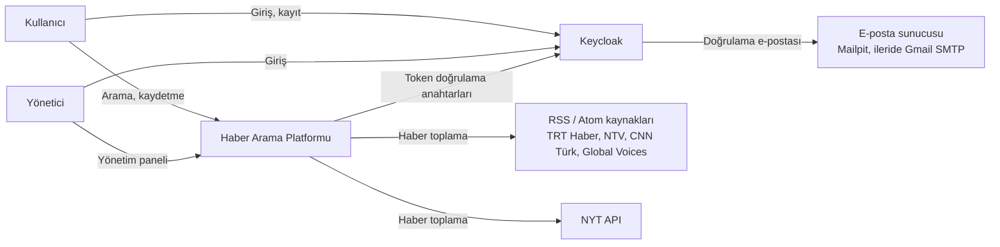
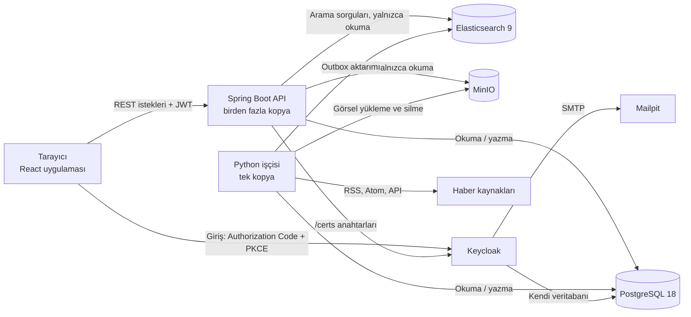
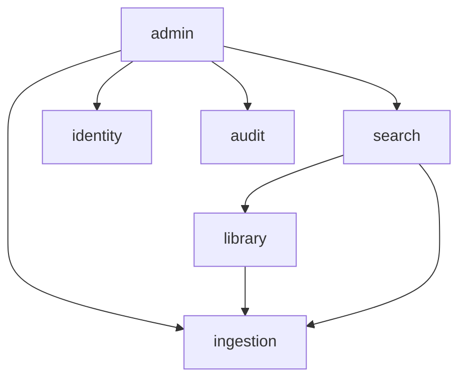
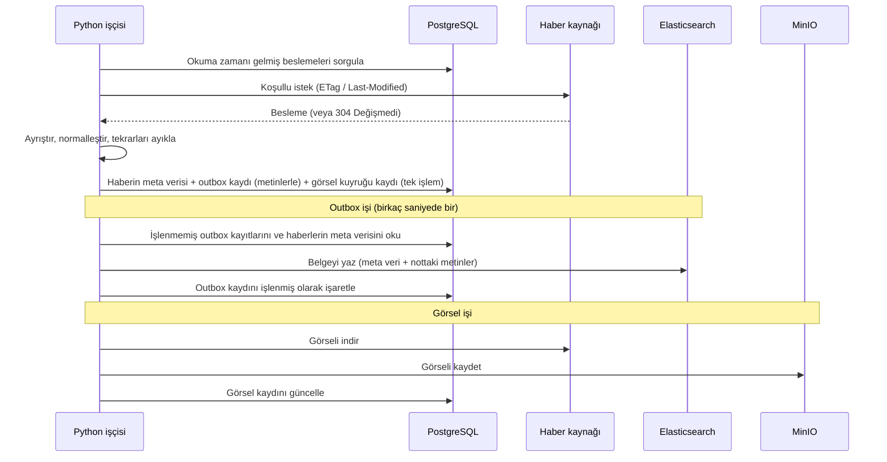
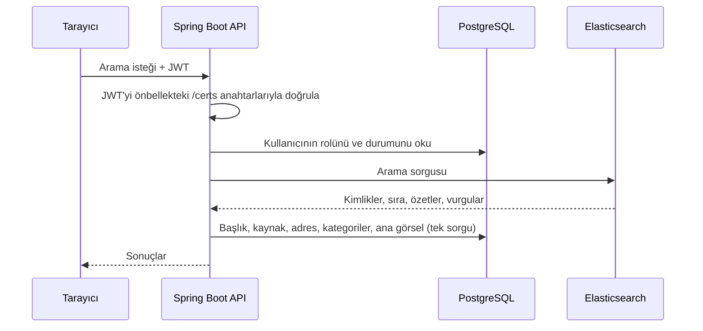
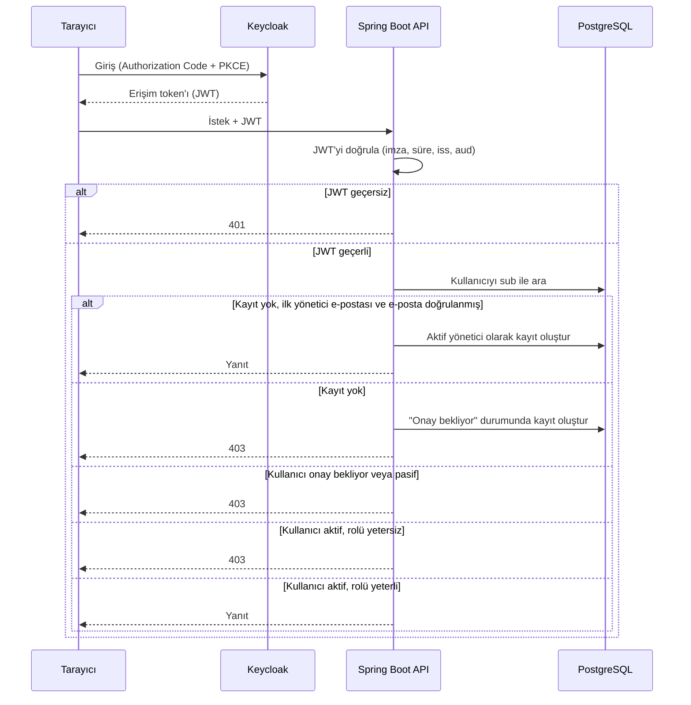
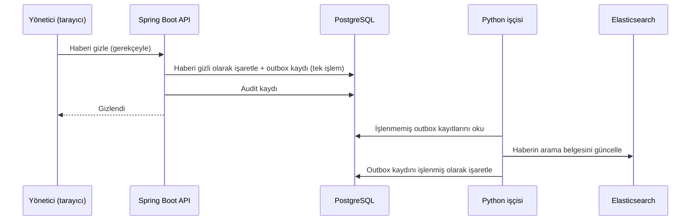

# Mimari

## 1. Amaç

Bu doküman, uygulamanın genel yapısını ve parçaların birbirleriyle nasıl çalıştığını anlatır. Yapı, C4 modelindeki gibi dıştan içe doğru üç düzeyde ele alınır: sistem bağlamı, bileşenler ve modüller.

Kararların gerekçeleri ilgili ADR'lerdedir:

| Konu | ADR |
|---|---|
| Depo yapısı | ADR-0001 |
| Haber kaynakları | ADR-0003, ADR-0004, ADR-0006, ADR-0009 |
| Mimari stil ve çalışma rolleri | ADR-0005 |
| Java, Spring Boot ve derleme aracı | ADR-0007 |
| Görsellerin depolanması | ADR-0010 |
| Veri depoları ve yaşam döngüsü | ADR-0011 |
| PostgreSQL ile Elasticsearch'ün eşitlenmesi | ADR-0012 |
| Veri toplama | ADR-0013 |
| Kimlik ve yetki | ADR-0014 |
| Kod ve veri modeli kuralları | ADR-0015 |
| Audit log | ADR-0016 |
| Python işçisi ve araçları | ADR-0017 |
| Geliştirme, test ve dağıtım araçları | ADR-0018 |

## 2. Sistem Bağlamı



| Aktör / Sistem | Rolü |
|---|---|
| Kullanıcı | Haberlerde arama yapar, haberleri görüntüler ve kaydeder. |
| Yönetici | Kullanıcıları, kaynakları ve sistemi yönetir. |
| Keycloak | Kullanıcının kimliğini doğrular ve JWT üretir; uygulama rolü tutmaz. |
| RSS / Atom kaynakları | Haberlerin beslemeler üzerinden toplandığı kaynaklar. |
| NYT API | Haberlerin API üzerinden toplandığı kaynak. |
| E-posta sunucusu | Keycloak'ın kayıt doğrulama e-postalarını gönderdiği sunucu. |

## 3. Bileşenler



| Bileşen | Görevi | Kopya sayısı | ADR |
|---|---|---|---|
| React uygulaması | Kullanıcı arayüzü ve yönetim paneli | — | — |
| Spring Boot API | Kullanıcı ve yönetici isteklerini karşılar; zamanlanmış işi yoktur | Birden fazla | ADR-0005, ADR-0017 |
| Python işçisi | Bütün arka plan işlerini yürütür: haber toplama, görsel indirme, outbox aktarımı, yaşam döngüsü güncellemesi, kaynak içeriğinin silinmesi, temizlik işleri | Tek | ADR-0013, ADR-0017 |
| PostgreSQL 18 | Asıl kayıt | — | ADR-0011 |
| Elasticsearch 9 | Türetilmiş arama indeksi | — | ADR-0011, ADR-0012 |
| MinIO | Görsel dosyaları | — | ADR-0010 |
| Keycloak | Kimlik doğrulama; verilerini PostgreSQL'de ayrı bir veritabanında tutar | — | ADR-0014 |
| Mailpit | Geliştirme ortamında e-posta yakalama | — | ADR-0014 |

API ile işçi yalnızca veri depoları üzerinden iletişim kurar (ADR-0017). Görseller tarayıcıya API üzerinden, imzalı adreslerle sunulur (`06-api-sozlesmesi.md`, 4.4).

## 4. Modüller

Backend, iş alanlarına göre altı modülden oluşur (ADR-0005; modül adları ADR-0015). Bir modül başka bir modülün iç sınıflarına doğrudan erişmez; yalnızca o modülün dışa açtığı arayüzleri kullanır.

| Modül | Sorumluluk | Çalıştığı uygulama |
|---|---|---|
| `identity` | Kullanıcı tablosu, kullanıcı durumları, token'daki kimliğin kullanıcıyla eşleştirilmesi, yetki kontrolü | API |
| `ingestion` | API'de: kaynak ve besleme yönetimi, elle toplama ve içerik silme taleplerinin oluşturulması. İşçide: zamanlama, RSS/Atom/API okuyucuları, normalleştirme, kategori eşlemesi, tekrar kontrolü, görsel indirme, kaynak içeriğinin silinmesi | API ve işçi |
| `search` | API'de: arama sorguları ve haber detayı (haber metinleri Elasticsearch'te olduğu için, ADR-0019). İşçide: outbox aktarımı, tam yeniden indeksleme, kaynaklar arası gruplama | API ve işçi |
| `library` | Kaydedilen haberler ve kaydedilmiş aramalar | API |
| `admin` | Yönetim paneli işlevleri ve istatistikler | API |
| `audit` | Denetim kayıtlarının yazılması, aranması ve dışa aktarılması. İşçi, sistem kayıtlarını doğrudan yazar. | API ve işçi |

Spring Boot API'de bu altı iş modülüne ek olarak `web` adında ortak bir teknik paket bulunur: hata yanıtlarının biçimi (RFC 9457), hata kodları ve istek kimliği buradadır. Bir iş modülü değildir; iş modülleri `web` paketini kullanır, `web` paketi hiçbir iş modülünü kullanmaz. Güvenliğe özgü 401 ve 403 yanıtları `identity` modülünde üretilir.

İşçi Python ile yazıldığından, modüllerin işçideki karşılıkları işçinin kendi paketleridir; modül sınırları iki uygulamada da aynı sorumluluk ayrımını izler.



Diyagram yalnızca başlıca bağımlılıkları gösterir:

- `library`, kaydedilen haberlerin başlığını, kaynağını ve görselini `ingestion`'dan alır; listede özet olmadığı için arama indeksine ihtiyaç duymaz.
- `search`, arama sonuçlarında ve haber detayında haberin kullanıcı tarafından kaydedilip kaydedilmediğini `library`'ye sorar. `library` `search`'ü kullanmadığından döngü oluşmaz; döngü olmadığını Spring Modulith testi her derlemede denetler.

Bunlara ek olarak:

- Bütün modüller, isteği yapan kullanıcının kimliğine ve rolüne erişmek için **identity** modülünü kullanır.
- Denetlenen işlemleri yapan modüller, kayıt için **audit** modülünü kullanır (FG-AL-01).

Modüller arası arayüzlerin ayrıntıları kod yazılırken netleşecektir.

## 5. Temel Akışlar

### 5.1 Haberin toplanması



### 5.2 Arama



Haber detayı da aynı şekilde iki depodan birleştirilir: meta veri ve görseller PostgreSQL'den, özet, tam metin ve yazar Elasticsearch'ten (ADR-0019).

### 5.3 Giriş ve yetki kontrolü



### 5.4 Elle toplama

```mermaid
sequenceDiagram
    participant Y as Yönetici (tarayıcı)
    participant A as Spring Boot API
    participant PG as PostgreSQL
    participant T as Python işçisi

    Y->>A: Toplamayı başlat
    A->>PG: Etkin beslemelerin okuma zamanını "şimdi" yap ve isteğin zamanını yaz
    A->>PG: Audit kaydı
    A-->>Y: Kabul edildi (202)
    T->>PG: Okuma zamanı gelmiş beslemeleri sorgula (en fazla 30 saniye içinde)
    T->>T: 5.1'deki toplama akışı; okuma MANUAL olarak kaydedilir
    T->>PG: Sonuç yazılırken istek tüketilir
```

İki uygulama doğrudan konuşmadığı için istek tabloda taşınır (`feeds.manual_fetch_requested_at`; ayrıntılar `05-veri-modeli.md`, 3.3).

### 5.5 Haberin gizlenmesi



Gizleme, outbox kaydı işlenene kadar (birkaç saniye) aramaya yansımayabilir (ADR-0012). Belge silinmez, gizli olarak işaretlenir (`hidden: true`); metinlerin tek kaydı belge olduğundan gizleme geri alındığında haber metniyle birlikte aramaya döner (ADR-0019).

### 5.6 Toplama sırasında uygulanan kurallar

- **Ortak istek sınırlayıcısı:** Besleme okuma ve görsel indirme işleri, aynı kaynağın bekleme süresine birlikte uyar. Toplayıcı tek kopya çalıştığından bu sınırlayıcı bellekte tutulur.
- **NYT istek bütçesi:** Günlük istek bütçesi takvim günü yerine son 24 saat üzerinden sayılır.
- **Tam metindeki görseller:** HTML içerik temizlenirken içerikteki `` etiketleri çıkarılır. Haberin görseli, `media` kaydından gösterilir.
- **NYT görselleri:** NYT aynı görseli farklı boyutlarda verdiğinden, her görselin yalnızca bir boyutu indirilir.
- **Görsel güvenliği:** Görsellerin boyutu en fazla 20 MB olabilir. Dosyanın gerçekten bir görsel olduğu, uzantısından değil içeriğinin ilk baytlarından doğrulanır. Görseller doğru `Content-Type` ve `X-Content-Type-Options: nosniff` başlıklarıyla sunulur.
- **Kaynak içeriğinin silinmesi (FG-YP-14):** Önce MinIO'daki dosyalar, ardından veritabanı kayıtları silinir; Elasticsearch için outbox kayıtları aynı işlemde yazılır.

## 6. Veri Yerleşimi

| Depo | Tuttuğu veri |
|---|---|
| PostgreSQL | Kullanıcılar, kaynaklar ve beslemeler, haberlerin meta verisi (başlık dahil) ve yaşam döngüsü durumu, görsel kayıtları, kaydedilen haberler ve aramalar, toplama işi kayıtları, outbox ve görsel kuyruğu, audit log |
| Elasticsearch | Haberlerin özeti, tam metni ve yazarı (tek kayıtları burasıdır, ADR-0019) ve aramada kullanılan meta verinin kopyası; aylık indeksler |
| MinIO | Görsel dosyaları |
| PostgreSQL (ayrı veritabanı) | Keycloak'ın kullanıcıları, oturumları ve olay kayıtları |

Yaşam döngüsü kuralları (sıcak, ılık, soğuk) ADR-0011'dedir. Ayrıntılı veri modeli `05-veri-modeli.md` dokümanında ele alınacaktır.

## 7. Henüz Verilmemiş Kararlar

| Konu | Açıklama |
|---|---|
| Gözlemlenebilirlik | Loglama, metrik toplama ve uyarı araçları |
| Dağıtım | Gateway API'yi uygulayacak bileşen ve konteyner imajları |
| Kategori eşlemesi | Kaynak kategorilerinin ortak listeye eşleme tablosu ve NYT bölümlerinin seçimi |
