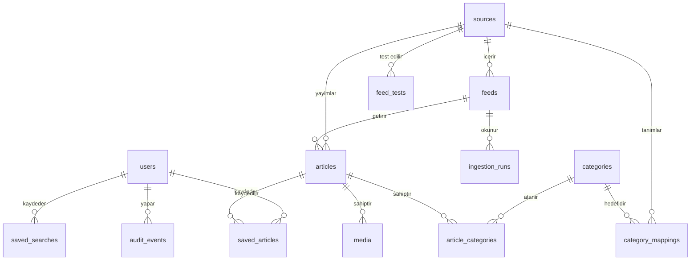

# Veri Modeli

## 1. Amaç

Bu doküman, PostgreSQL tablolarını, Elasticsearch belge yapısını, MinIO'daki dosya düzenini ve veritabanı kullanıcılarını tanımlar. Kurallar ADR-0015'te, veri depolarının rolleri ve yaşam döngüsü ADR-0011'de, audit log tasarımı ADR-0016'dadır.

Genel kurallar (ADR-0015):

- Birincil anahtarlar `uuid` türündedir ve varsayılan değeri `uuidv7()` fonksiyonuyla üretilir.
- Zaman alanları `timestamptz` türündedir ve UTC olarak saklanır.
- Her tabloda `created_at` ve `updated_at` bulunur; ilişki tablolarında yalnızca `created_at` bulunur.
- Sabit değer kümeleri `text` türünde ve `CHECK` kısıtıyla tutulur.
- Yöneticilerin düzenlediği tablolarda iyimser kilitleme için `version` sütunu bulunur.
- `updated_at` alanı, satır güncellendiğinde bir tetikleyiciyle veritabanında güncellenir; değişikliği kimin yaptığı `audit_events` tablosunda tutulur.

## 2. Tablolar Arası İlişkiler

`outbox_events` ve `audit_events` tablolarındaki haber ve hedef kimlikleri bilinçli olarak yabancı anahtar değildir (bkz. 3.10 ve 3.13).

## 3. PostgreSQL Tabloları

### 3.1 `users` (modül: identity)

| Sütun | Tür | Kural | Açıklama |
|---|---|---|---|
| `id` | `uuid` | Birincil anahtar | |
| `keycloak_sub` | `text` | Zorunlu, benzersiz | Keycloak'taki değişmeyen kullanıcı kimliği; eşleştirme bununla yapılır (R-15) |
| `email` | `text` | Zorunlu | Token'dan alınır; eşleştirmede kullanılmaz |
| `display_name` | `text` | | Token'dan alınan ad |
| `role` | `text` | Zorunlu; `USER`, `ADMIN` | |
| `status` | `text` | Zorunlu; `PENDING`, `ACTIVE`, `PASSIVE`, `REJECTED` | |
| `last_session_id` | `text` | | Son kaydedilen Keycloak oturum kimliği (ADR-0016) |
| `version` | `integer` | Zorunlu | |
| `created_at`, `updated_at` | `timestamptz` | Zorunlu | |

- İlk istekte kayıt yoksa `PENDING` durumunda oluşturulur; aynı anda gelen iki istekte ikinci ekleme benzersizlik kısıtına takılır ve atlanır.
- `email`, `display_name` ve `last_session_id` uygulama tarafından, yalnızca değer değiştiğinde ve sürüm kontrolü yapılmadan güncellenir (ADR-0015).

### 3.2 `sources` (modül: ingestion)

| Sütun | Tür | Kural | Açıklama |
|---|---|---|---|
| `id` | `uuid` | Birincil anahtar | |
| `code` | `text` | Zorunlu, benzersiz | Değişmeyen kod: `TRT`, `NTV`, `CNNTURK`, `GLOBALVOICES`, `NYT` |
| `name` | `text` | Zorunlu, benzersiz | Görünen ad |
| `homepage_url` | `text` | Zorunlu | Atıfta kullanılan ana sayfa |
| `reader_type` | `text` | Zorunlu; `RSS`, `ATOM`, `NYT_TOP_STORIES` | Beslemelerin ayrıştırıldığı okuyucu |
| `language` | `text` | Zorunlu; `tr`, `en` | |
| `request_interval_seconds` | `integer` | Zorunlu, sıfırdan büyük | İki istek arasında beklenecek süre |
| `daily_request_limit` | `integer` | Boş olabilir, sıfırdan büyük | Son 24 saatteki en fazla istek sayısı; boşsa sınır yok (NYT için 400) |
| `field_mapping` | `jsonb` | | Alanların nereden okunacağı |
| `feed_time_zone` | `text` | | Beslemedeki saatlerin gerçekte yazıldığı saat dilimi (IANA adı, örnek `Europe/Istanbul`); boşsa beslemede yazan saat dilimine güvenilir |
| `license` | `text` | | Kullanım hakkının dayanağı |
| `attribution_text` | `text` | | Arayüzde gösterilecek atıf metni |
| `purge_requested_at` | `timestamptz` | | Kaynak içeriğinin silinmesi istendiğinde dolar; işçi silmeyi tamamladığında boşaltır (FG-YP-14) |
| `enabled` | `boolean` | Zorunlu, varsayılan `true` | |
| `version` | `integer` | Zorunlu | |
| `created_at`, `updated_at` | `timestamptz` | Zorunlu | |

- API anahtarları bu tabloda tutulmaz; kaynağın `code` değerine göre yapılandırmadan okunur.
- `field_mapping`, kaynağın standart dışı etiketlerini okuyucuya tanıtır. Şu an tek anahtar `image`'dır: haberin ana görselinin okunacağı etiketin adı. Örnek: CNN Türk için `{"image": "image"}` (`V12` betiği). Değer boşsa görsel standart alanlardan okunur (ADR-0017, 8. bölüm).
- `feed_time_zone`, saat dilimini yanlış yazan kaynaklar içindir: doluysa okuyucu beslemedeki saati bu saat diliminde okur, yanındaki saat dilimi bilgisini yok sayar. CNN Türk Türkiye saatini yazıp yanına "GMT" koyduğu için değeri `Europe/Istanbul`'dur; `V15` betiği ayrıca CNN Türk'ün daha önce 3 saat ileri kaydedilen haberlerini düzeltti. Tanınmayan bir ad okumayı başarısız yapar ve nedeni toplama geçmişinde görünür (ADR-0017, 8. bölüm).

### 3.3 `feeds` (modül: ingestion)

| Sütun | Tür | Kural | Açıklama |
|---|---|---|---|
| `id` | `uuid` | Birincil anahtar | |
| `source_id` | `uuid` | Zorunlu, `sources` | |
| `name` | `text` | Zorunlu | |
| `url` | `text` | Zorunlu, benzersiz | Besleme adresi; anahtar içermez |
| `default_category_id` | `uuid` | `categories`, boş olabilir | Besleme düzeyindeki kategori |
| `use_item_categories` | `boolean` | Zorunlu | Haber düzeyinde eşleme uygulanır mı |
| `fetch_interval_minutes` | `integer` | Zorunlu, varsayılan 15 | |
| `next_fetch_at` | `timestamptz` | Zorunlu | Bir sonraki okuma zamanı |
| `etag`, `last_modified` | `text` | | Koşullu istek için |
| `consecutive_failures` | `integer` | Zorunlu, varsayılan 0 | |
| `last_success_at` | `timestamptz` | | |
| `last_error` | `text` | | |
| `enabled` | `boolean` | Zorunlu, varsayılan `true` | |
| `disabled_reason` | `text` | `MANUAL`, `AUTO` | |
| `version` | `integer` | Zorunlu | |
| `created_at`, `updated_at` | `timestamptz` | Zorunlu | |

- Benzersiz: `(source_id, name)`.
- Kısıt: `enabled` `false` ise `disabled_reason` dolu, `true` ise boş olmalıdır.
- İndeks: `(enabled, next_fetch_at)`.
- Zamanlama ve sağlık alanları işçi tarafından, sürüm kontrolü yapılmadan güncellenir (ADR-0015).
- İşçi, kaynağı devre dışı olan beslemeleri okumaz.

### 3.4 `categories` (modül: ingestion)

| Sütun | Tür | Kural | Açıklama |
|---|---|---|---|
| `id` | `uuid` | Birincil anahtar | |
| `code` | `text` | Zorunlu, benzersiz | |
| `kind` | `text` | Zorunlu; `TOPIC`, `TEMPORAL` | Konu kategorisi mi, zaman etiketi mi |
| `sort_order` | `integer` | Zorunlu | Arayüzdeki sıra |
| `window_hours` | `integer` | Boş olabilir, sıfırdan büyük | Doluysa kategori yalnızca bu süre içinde yayımlanan haberleri gösterir |
| `created_at`, `updated_at` | `timestamptz` | Zorunlu | |

Başlangıç verisi:

| `code` | Kategori | `kind` | `window_hours` |
|---|---|---|---|
| `GENERAL` | Gündem | `TOPIC` | |
| `WORLD` | Dünya | `TOPIC` | |
| `ECONOMY` | Ekonomi | `TOPIC` | |
| `SPORTS` | Spor | `TOPIC` | |
| `HEALTH` | Sağlık | `TOPIC` | |
| `SCIENCE_TECH` | Bilim ve Teknoloji | `TOPIC` | |
| `CULTURE_ARTS` | Kültür ve Sanat | `TOPIC` | |
| `LIFESTYLE` | Yaşam | `TOPIC` | |
| `BREAKING` | Son Dakika | `TEMPORAL` | 6 |
| `OTHER` | Diğer | `TOPIC` | |

- Kategorilerin görünen adları tabloda değil, arayüzün dil dosyalarında tutulur (FOG-31).
- Hiçbir `TOPIC` kategorisi atanamayan haber `OTHER` kategorisine atanır (FG-VT-13).

### 3.5 `category_mappings` (modül: ingestion)

| Sütun | Tür | Kural | Açıklama |
|---|---|---|---|
| `id` | `uuid` | Birincil anahtar | |
| `source_id` | `uuid` | Zorunlu, `sources` | |
| `source_category` | `text` | Zorunlu | Kaynağın kategori değeri; normalleştirilmiş olarak saklanır |
| `category_id` | `uuid` | Zorunlu, `categories` | |
| `created_at`, `updated_at` | `timestamptz` | Zorunlu | |

- Benzersiz: `(source_id, source_category)`.
- Normalleştirme: Baştaki ve sondaki boşluklar atılır, değer kaynağın dilinin kurallarıyla küçük harfe çevrilir (Türkçe kaynaklarda "I" → "ı", "İ" → "i").
- Eşlemeler veritabanı geçiş betikleriyle eklenir. Başlangıç eşlemeleri (47 satır) `V13__seed_category_mappings.sql` betiğindedir; eşleme tablosunun tek kaynağı bu betiktir.
- Kaynağın kategori değeri, kategori etiketi veren kaynaklarda (NTV, Global Voices) etikettir. Etiket vermeyen kaynaklarda (TRT Haber, CNN Türk) haber adresinin klasör kısımlarıdır: `trthaber.com/haber/ekonomi/...` adresinde `ekonomi`. Tabloda bulunmayan değer eşlenmez (ADR-0017, 9. bölüm).

### 3.6 `articles` (modül: ingestion)

| Sütun | Tür | Kural | Açıklama |
|---|---|---|---|
| `id` | `uuid` | Birincil anahtar | Elasticsearch belge kimliğiyle aynı |
| `source_id` | `uuid` | Zorunlu, `sources` | |
| `feed_id` | `uuid` | `feeds` | Haberi ilk getiren besleme |
| `external_id` | `text` | Zorunlu | Kaynağın verdiği kimlik |
| `url` | `text` | Zorunlu | Özgün habere bağlantı; değiştirilmez |
| `normalized_url` | `text` | Zorunlu | Tekrar kontrolü için |
| `title` | `text` | Zorunlu | |
| `language` | `text` | Zorunlu; `tr`, `en` | |
| `item_type` | `text` | Zorunlu; `ARTICLE`, `VIDEO`, `GALLERY` | |
| `published_at` | `timestamptz` | Zorunlu | Kaynak vermezse toplanma zamanı |
| `fetched_at` | `timestamptz` | Zorunlu | |
| `lifecycle_state` | `text` | Zorunlu; `HOT`, `WARM`, `COLD` | |
| `group_id` | `uuid` | Boş olabilir | Kaynaklar arası grup; başka bir tabloya bağlı değildir |
| `hidden` | `boolean` | Zorunlu, varsayılan `false` | |
| `hidden_reason` | `text` | | |
| `hidden_at` | `timestamptz` | | |
| `hidden_by` | `uuid` | `users` | |
| `created_at`, `updated_at` | `timestamptz` | Zorunlu | |

- Tablo haberin meta verisini tutar. Özet, tam metin (temizlenmiş HTML) ve yazar burada tutulmaz; tek kayıtları Elasticsearch belgesidir (5.2, ADR-0019). Bu sütunları `V14__article_texts_in_elasticsearch.sql` betiği kaldırdı; betik, silmeden önce Elasticsearch'e henüz aktarılmamış metinleri (işlenmemiş notların haberleri ve gizlenmiş haberler) outbox notlarına taşır.
- Benzersiz: `(source_id, external_id)` ve `(source_id, normalized_url)` (FG-VT-04). Tekrar eden haber görmezden gelinir; yalnızca eksik kategorileri eklenir (ADR-0017, 10. bölüm).
- Kısıt: `hidden` `true` ise `hidden_at` ve `hidden_by` dolu olmalıdır.
- İndeksler: `(lifecycle_state, published_at)`, `(source_id, published_at)`, `fetched_at`.
- Tablo bölümlenmez (ADR-0015).
- Yaşam döngüsü durumu, işçideki günlük işle `published_at` değerine göre güncellenir: 30 günden yeni `HOT`, 30 gün ile 1 yıl arası `WARM`, 1 yıldan eski `COLD`.

### 3.7 `article_categories` (modül: ingestion)

| Sütun | Tür | Kural | Açıklama |
|---|---|---|---|
| `article_id` | `uuid` | `articles` | |
| `category_id` | `uuid` | `categories` | |
| `mapping_level` | `text` | Zorunlu; `FEED`, `ITEM` | Kategorinin hangi düzeyde atandığı |
| `created_at` | `timestamptz` | Zorunlu | |

- Birincil anahtar: `(article_id, category_id)`.
- Aynı kategori iki düzeyde de bulunursa `FEED` olarak kaydedilir. Hiçbir konu kategorisi atanamadığı için eklenen Diğer kategorisinin düzeyi `ITEM`'dır.

### 3.8 `media` (modül: ingestion)

| Sütun | Tür | Kural | Açıklama |
|---|---|---|---|
| `id` | `uuid` | Birincil anahtar | |
| `article_id` | `uuid` | Zorunlu, `articles` | |
| `media_type` | `text` | Zorunlu; `IMAGE`, `VIDEO` | Şimdilik yalnızca `IMAGE` |
| `position` | `integer` | Zorunlu | 0 ana görsel |
| `source_url` | `text` | Zorunlu | Kaynaktaki adres |
| `status` | `text` | Zorunlu; `PENDING`, `DOWNLOADED`, `FAILED` | |
| `attempts` | `integer` | Zorunlu, varsayılan 0 | |
| `next_attempt_at` | `timestamptz` | | |
| `last_error` | `text` | | |
| `storage_key` | `text` | | MinIO'daki anahtar; indirildikten sonra dolar |
| `content_type` | `text` | | |
| `size_bytes` | `bigint` | | |
| `width`, `height` | `integer` | | |
| `caption` | `text` | | |
| `credit` | `text` | | Fotoğrafçı veya lisans bilgisi |
| `created_at`, `updated_at` | `timestamptz` | Zorunlu | |

- Benzersiz: `(article_id, source_url)`.
- Kısıt: `status` `DOWNLOADED` ise `storage_key` dolu olmalıdır.
- İndeks: `(status, next_attempt_at)`.
- Tablo aynı zamanda görsel indirme kuyruğudur (ADR-0013): `PENDING` durumundaki ve deneme zamanı gelmiş kayıtlar indirilir. Kalıcı hatada (404, 410, görsel değil, 20 MB'tan büyük) hemen, geçici hatada 5. denemede `FAILED` olur; geçici hatalar 1, 5, 15 ve 15 dakika sonra yeniden denenir (ADR-0017, 12. bölüm).
- Görseller MinIO'ya ortak biçimde yazılır: WebP, en uzun kenar en fazla 1600 piksel (ADR-0017, 12. bölüm). `content_type` bu yüzden `image/webp`'dir; `size_bytes`, `width` ve `height` dönüştürülmüş dosyanındır. `attempts`, başarılı indirme dahil yapılan deneme sayısıdır.

### 3.9 `ingestion_runs` (modül: ingestion)

| Sütun | Tür | Kural | Açıklama |
|---|---|---|---|
| `id` | `uuid` | Birincil anahtar | |
| `feed_id` | `uuid` | Zorunlu, `feeds` | |
| `trigger` | `text` | Zorunlu; `SCHEDULED`, `MANUAL` | |
| `status` | `text` | Zorunlu; `RUNNING`, `SUCCEEDED`, `NOT_MODIFIED`, `FAILED` | |
| `started_at` | `timestamptz` | Zorunlu | |
| `finished_at` | `timestamptz` | | |
| `http_status` | `integer` | | |
| `final_url` | `text` | | Yönlendirmeler takip edildikten sonra varılan adres |
| `items_received` | `integer` | | |
| `items_new` | `integer` | | |
| `items_duplicate` | `integer` | | |
| `items_failed` | `integer` | | Bozuk olduğu için atlanan haber sayısı |
| `error_message` | `text` | | |
| `created_at`, `updated_at` | `timestamptz` | Zorunlu | |

- İndeksler: `(feed_id, started_at)` ve saklama süresi dolan kayıtların silinmesi için `started_at`.
- Kaynakların günlük istek sınırı, bu tablodaki son 24 saatlik kayıtlardan hesaplanır.
- Saklama süresi önerisi 180 gündür; kesin süre veri büyümesi analizinde belirlenecektir.

### 3.10 `outbox_events` (modül: search)

| Sütun | Tür | Kural | Açıklama |
|---|---|---|---|
| `id` | `uuid` | Birincil anahtar | İşleme sırasını da belirler |
| `article_id` | `uuid` | Zorunlu | Yabancı anahtar değildir |
| `operation` | `text` | Zorunlu; `INDEX`, `DELETE` | |
| `status` | `text` | Zorunlu; `PENDING`, `PROCESSED` | |
| `attempts` | `integer` | Zorunlu, varsayılan 0 | |
| `next_attempt_at` | `timestamptz` | | |
| `last_error` | `text` | | |
| `processed_at` | `timestamptz` | | |
| `payload` | `jsonb` | | Haber ilk kaydedilirken yazılan kayıtta özet, tam metin ve yazar (`summary`, `content`, `author`); kayıt işlenince boşaltılır. Diğer kayıtlarda boştur |
| `created_at`, `updated_at` | `timestamptz` | Zorunlu | |

- İndeks: `status = 'PENDING'` olan satırları kapsayan, `next_attempt_at` üzerinde kısmi indeks.
- `article_id` yabancı anahtar değildir: Silinen bir haberin `DELETE` kaydının, haber silindikten sonra da var olabilmesi gerekir.
- Haberin metinleri, haberle aynı işlemde yazılan kaydın `payload` alanıyla Elasticsearch'e taşınır; haber ve kayıt birlikte yazıldığından metin kaybolmaz. Kayıt işlenince metin silinir; PostgreSQL'de kopyası kalmaz (ADR-0019).
- İşleyen iş meta veriyi haberin PostgreSQL'deki güncel halinden okur ve kararını ona göre verir: haber yoksa belgesi silinir; haber duruyorsa ve kayıt metin taşıyorsa belge baştan yazılır, taşımıyorsa belgede yalnızca meta veri alanları güncellenir. Gizlenmiş haberin belgesi silinmez, `hidden` alanı güncellenir (5.2). `operation` yalnızca kaydın neden oluştuğunu gösterir, kararı değiştirmez; bir kaydın geç veya iki kez işlenmesi yanlış sonuç üretmez (ADR-0017, 11. bölüm).
- Haber gizlendiğinde ve gizleme geri alındığında `INDEX` kaydı oluşturulur. `DELETE` kaydı yalnızca haber silindiğinde (kaynak içeriğinin silinmesi) yazılır.
- Kayıtlardan vazgeçilmez. Elasticsearch'in reddettiği kayıt 1, 5 ve 15 dakika sonra, ardından 15 dakikada bir yeniden denenir (`attempts`, `last_error`, `next_attempt_at`); Elasticsearch'e ulaşılamadığında kayıtlara dokunulmaz ve bir sonraki turda yeniden denenir. İşlenmiş kayıtlar belirli bir süre sonra (öneri: 7 gün) silinir.

### 3.11 `saved_articles` (modül: library)

| Sütun | Tür | Kural | Açıklama |
|---|---|---|---|
| `user_id` | `uuid` | `users` | |
| `article_id` | `uuid` | `articles` | |
| `created_at` | `timestamptz` | Zorunlu | |

- Birincil anahtar: `(user_id, article_id)`.
- İndeksler: `(user_id, created_at)` ve bir haber silindiğinde kayıtlarının bulunması için `article_id`.
- Kaydetme `INSERT ... ON CONFLICT DO NOTHING` ile yapılır: aynı haberi ikinci kez kaydetmek hata vermez ve `created_at` ilk kaydedildiği an olarak kalır. Liste `created_at DESC, article_id DESC` ile sıralanır (API sözleşmesi 5.1).

### 3.12 `saved_searches` (modül: library)

| Sütun | Tür | Kural | Açıklama |
|---|---|---|---|
| `id` | `uuid` | Birincil anahtar | |
| `user_id` | `uuid` | Zorunlu, `users` | |
| `name` | `text` | Zorunlu | |
| `query` | `text` | | |
| `filters` | `jsonb` | | Kaynak, dil, kategori, tarih aralığı, sıralama |
| `created_at`, `updated_at` | `timestamptz` | Zorunlu | |

- Benzersiz: `(user_id, name)`.
- Tarih filtresi göreli olarak saklanır (örneğin "son 7 gün").

### 3.13 `audit_events` (modül: audit)

| Sütun | Tür | Kural | Açıklama |
|---|---|---|---|
| `id` | `uuid` | | |
| `occurred_at` | `timestamptz` | Zorunlu | Bölümleme anahtarı |
| `actor_type` | `text` | Zorunlu; `USER`, `SYSTEM` | |
| `actor_user_id` | `uuid` | | Yabancı anahtar değildir |
| `action` | `text` | Zorunlu | İşlem kodu |
| `target_type` | `text` | | |
| `target_id` | `uuid` | | |
| `result` | `text` | Zorunlu; `SUCCESS`, `FAILURE` | |
| `request_id` | `text` | | |
| `ip_address` | `inet` | | |
| `details` | `jsonb` | | Yalnızca işleme göre önceden tanımlanmış alanlar |

- Birincil anahtar: `(id, occurred_at)`.
- Tablo `occurred_at` alanına göre aylara bölümlenir; bölümler geçiş betikleriyle 2028 sonuna kadar oluşturulur ve bir varsayılan bölüm bulunur.
- İndeksler: `occurred_at`, `(actor_user_id, occurred_at)`, `(action, occurred_at)`, `(target_type, target_id)`.
- Tablodaki güncelleme, silme ve `TRUNCATE` işlemleri tetikleyicilerle reddedilir.
- Kısıt: `actor_type` `USER` ise `actor_user_id` dolu, `SYSTEM` ise boş olmalıdır.
- Kayıtlar başka tablolara yabancı anahtarla bağlanmaz: Bölümlenmiş tabloda yabancı anahtarlar yazma maliyetini artırır ve audit kaydı, bağlı olduğu nesne değişse de olduğu gibi kalmalıdır.
- Tabloda `updated_at` bulunmaz; kayıtlar hiç güncellenmez.
- `occurred_at` veritabanının saatiyle dolar. `request_id`, yanıttaki `X-Request-Id` değeridir (API sözleşmesi 2.7). `ip_address`, API'de Traefik'in yazdığı `X-Forwarded-For` başlığından okunur: Traefik güvenmediği kaynaktan gelen `X-Forwarded-*` başlıklarını siler, Spring Boot (Tomcat) da başlığı yalnızca iç ağ adreslerinden gelen isteklerde kullanır (`server.forward-headers-strategy: native`); istemci adresini kendisi uyduramaz (ADR-0016, 6. bölüm). İşçinin yazdığı kayıtlarda `request_id` ve `ip_address` boştur.
- İşlem kodları (yeni denetlenen işlemler aynı biçimde eklenir):

| `action` | Yazan | `actor_type` | `target_type` | `result` | `details` |
|---|---|---|---|---|---|
| `USER_REGISTERED` | API, kullanıcının ilk isteğinde (ADR-0014) | `USER` (kaydı oluşan kullanıcı) | `USER` | `SUCCESS` | `role`, `status` |
| `SESSION_STARTED` | API, token'daki `sid` kullanıcının `last_session_id` değerinden farklıysa | `USER` | `USER` | `SUCCESS` | — (oturum kimliği yazılmaz) |
| `ACCESS_DENIED` | API, kimliği doğrulanmış kullanıcının isteği 403 aldığında | `USER` | — | `FAILURE` | `method`, `path` (sorgu metni olmadan, FG-AL-05), `code` (ret nedeni, örneğin `USER_PENDING_APPROVAL`) |
| `USER_APPROVED` | API, yönetici onay bekleyen kullanıcıyı onayladığında (FG-YP-01) | `USER` (yönetici) | `USER` | `SUCCESS` veya `FAILURE` | — |
| `USER_REJECTED` | API, yönetici onay bekleyen kullanıcıyı reddettiğinde | `USER` (yönetici) | `USER` | `SUCCESS` veya `FAILURE` | — |
| `USER_ROLE_CHANGED` | API, yönetici kullanıcının rolünü değiştirdiğinde (FG-YP-02) | `USER` (yönetici) | `USER` | `SUCCESS` veya `FAILURE` | `from`, `to` |
| `USER_STATUS_CHANGED` | API, yönetici kullanıcıyı aktif veya pasif yaptığında | `USER` (yönetici) | `USER` | `SUCCESS` veya `FAILURE` | `from`, `to` |
| `FEED_AUTO_DISABLED` | İşçi (ADR-0017, 10. bölüm) | `SYSTEM` | `FEED` | `SUCCESS` | `consecutive_failures`, `last_error` |

- `USER_REGISTERED` ve `SESSION_STARTED`, kullanıcı kaydı ve `last_session_id` güncellemesiyle aynı veritabanı işleminde yazılır. Aynı anda gelen iki istekten yalnızca eklemeyi veya koşullu güncellemeyi başaran istek kayıt yazar; kayıt bir kez oluşur. `ACCESS_DENIED` bir iş işlemine bağlı değildir, ayrı yazılır; yazılamazsa istek yine 403 alır ve hata uygulama loguna düşer.
- Kullanıcı yönetimi işlemlerinin başarılı kaydı değişiklikle aynı veritabanı işleminde yazılır. İş kuralıyla reddedilen denemede (`409`: yanlış durum, sürüm çakışması, son aktif yönetici) değişiklik geri alınır; deneme bu yüzden işlem bittikten sonra ayrıca `FAILURE` sonucuyla yazılır. Ayrıntıda ret nedeni (`code`, örneğin `LAST_ACTIVE_ADMIN`) ve rol ile durum değişikliklerinde istenen değer (`to`) bulunur. Bir `PATCH` isteğinde rol ve durum birlikte istendiyse her biri ayrı kayıttır.

### 3.14 `feed_tests` (modül: ingestion)

| Sütun | Tür | Kural | Açıklama |
|---|---|---|---|
| `id` | `uuid` | Birincil anahtar | |
| `source_id` | `uuid` | Zorunlu, `sources` | Ayarları kullanılacak kaynak |
| `url` | `text` | Zorunlu | Test edilecek adres |
| `requested_by` | `uuid` | Zorunlu, `users` | Testi isteyen yönetici |
| `status` | `text` | Zorunlu; `PENDING`, `SUCCEEDED`, `FAILED` | |
| `result` | `jsonb` | | HTTP durum kodu, bulunan haber sayısı ve örnek haber |
| `error` | `text` | | |
| `completed_at` | `timestamptz` | | |
| `created_at`, `updated_at` | `timestamptz` | Zorunlu | |

- İndeks: `status = 'PENDING'` olan satırları kapsayan, `created_at` üzerinde kısmi indeks.
- Test sonuçları kalıcı bir değer taşımadığından kısa süre sonra (öneri: 1 gün) silinir.

## 4. Silme Davranışları

| Silinen | Etki |
|---|---|
| Haber | `article_categories`, `media` ve `saved_articles` satırları da silinir. Haberlerin silindiği tek yol kaynak içeriğinin silinmesidir (FG-YP-14): Önce MinIO'daki dosyalar, ardından satırlar silinir; Elasticsearch için `DELETE` outbox kayıtları aynı işlemde yazılır. |
| Kullanıcı, kaynak, besleme, kategori | Silinmez; kullanıcıların durumu değiştirilir, kaynaklar ve beslemeler devre dışı bırakılır. Bu tablolara bağlanan yabancı anahtarlar silmeyi engelleyecek şekilde tanımlanır. |

## 5. Elasticsearch

### 5.1 İndeksler

- Haberler, yayın tarihinin ayına göre aylık indekslerde tutulur. İndeks adı ayın ilk gününü içerir: `articles-g1-2026.11.01`. `g1`, indeks neslini gösterir (bkz. 5.4).
- İndekslerde `index.lifecycle.parse_origination_date` ayarı açıktır; indeksin yaşı, adındaki tarihten hesaplanır. Böylece geçmiş tarihli haberlerin yüklendiği indeksler de doğru yaşta kabul edilir.
- Aramalar etkin neslin bütün aylık indekslerini kapsayan `articles` takma adı (alias) üzerinden yapılır.
- Aylık indeksler elle açılmaz. Her neslin bir indeks şablonu vardır (`articles-g1`, kapsamı `articles-g1-*`): alanları, analizörleri, ayarları (tek parça, kopya sayısı 0, yaşam döngüsü politikası) ve takma adı tanımlar; bir aya ait ilk haber yazıldığında Elasticsearch indeksi bu şablonla açar. Şablonu işçi kurar. Takma adı yalnızca etkin neslin şablonu taşır; etkin nesil, takma adı taşıyan şablonun neslidir.
- Aylık indeks, haberin yayın tarihinin UTC'deki ayına göre seçilir.
- Şablon tanımlı olmayan alanları reddeder (`dynamic: strict`).

### 5.2 Belge alanları

| Alan | Tür | Açıklama |
|---|---|---|
| belge kimliği | | Haberin PostgreSQL'deki `id` değeri |
| `source_code` | `keyword` | Kaynak filtresi için |
| `language` | `keyword` | Dil filtresi için |
| `item_type` | `keyword` | |
| `categories` | `keyword` (çok değerli) | Kategori kodları |
| `published_at` | `date` | |
| `group_id` | `keyword` | Gruplanmış haberlerin tek sonuç olarak gösterilmesi için |
| `hidden` | `boolean` | Haber gizlenmişse `true`; arama bu belgeleri dışarıda bırakır |
| `title_tr`, `summary_tr`, `content_tr` | `text`, `turkish_article` analizörü | Yalnızca Türkçe haberlerde dolar. Tam metin HTML olarak yazılır (ADR-0019) |
| `title_tr.folded`, `summary_tr.folded`, `content_tr.folded` | `text`, `turkish_folded` analizörü | Alt alan; belgeye ayrıca yazılmaz, Elasticsearch aynı metni ikinci bir biçimde indeksler |
| `title_en`, `summary_en`, `content_en` | `text`, `english_article` analizörü | Yalnızca İngilizce haberlerde dolar. Tam metin HTML olarak yazılır |
| `author` | `keyword`, indekslenmez | Yalnızca gösterilir; aranmaz ve sıralanmaz |

- Özet, tam metin ve yazarın tek kaydı Elasticsearch'tir; PostgreSQL haberin meta verisini tutar (ADR-0019). Başlık iki depoda da durur.
- `turkish_article` ve `english_article`, Elasticsearch'ün yerleşik `turkish` ve `english` analizörlerinin Elastic dokümanındaki tanımlarıyla yeniden kurulmuş halleridir; başlarında HTML etiketlerini atan ve kodlanmış karakterleri çözen `html_strip` süzgeci vardır. HTML'siz metinde yerleşik analizörlerle aynı kelimeleri ürettikleri testle denetlenir. Tam metin HTML olarak saklandığı halde etiket ve bağlantı adresleri aranabilir kelime olmaz.
- Bir dilin bütün metin alanları aynı analizörü kullanır: arama `cross_fields` yöntemini kullanır ve Elasticsearch yalnızca aynı analizörlü alanları birlikte değerlendirir (5.5).
- Türkçe analizör gerçek haberlerle denendi (ADR-0017, 11. bölüm): Türkçe karaktersiz yazımı (`cumhurbaskani`), noktasız büyük I'yı (`ISTANBUL`) ve bazı kelimelerde tekil ile çoğulu (`seçim` / `seçimler`) eşleştirmiyor. Bunun için Türkçe alanların `folded` alt alanı vardır; analizörü HTML etiketlerini atar, kesme işaretinden sonrasını atar, Türkçe kurallarıyla küçük harfe çevirir, harfleri ASCII karşılığına çevirir ve kelimenin ilk beş harfini alır. Kaba eşleşmeler üretebildiğinden aramada asıl alandan düşük ağırlık alır.
- Değeri olmayan alan belgeye konmaz.
- Arama, iki dilin alanlarında birlikte yapılır. Alan ağırlıkları başlık, özet ve tam metin sırasıyla azalır (FG-AR-01); değerler ve sorgunun diğer kuralları 5.5'tedir.
- Gizlenen haberin belgesi indekste kalır ve `hidden: true` olarak işaretlenir; arama ve haber detayı bu haberi göstermez. Belge silinmez, çünkü metinlerin tek kaydıdır: gizleme geri alındığında haber metniyle birlikte aramaya döner (ADR-0019).
- Görseller, kaynak adı ve atıf bilgisi indekste tutulmaz; arama sonuçlarındaki haberler için PostgreSQL'den tek bir toplu sorguyla alınır.

### 5.3 Yaşam döngüsü politikası

| Aşama | İndeks yaşı | İşlem |
|---|---|---|
| Sıcak | 0 – 60 gün | Yok |
| Ilık | 60 gün sonra | Birleştirme (force merge) |
| Soğuk | 395 gün sonra | Düşük öncelik |

- İndeks yaşı ayın ilk gününden hesaplandığından, aşama süreleri bir aylık indeksteki **bütün** haberlerin ilgili yaşa ulaştığı ana göre seçilmiştir: 60 günlük bir indeksteki en yeni haber 30 günlük, 395 günlük bir indeksteki en yeni haber 1 yıllıktır. Böylece Elasticsearch'teki aşamalar, PostgreSQL'deki durumlardan önce değişmez.
- İndeksler hiçbir aşamada salt okunur yapılmaz (ADR-0015).
- Soğuk haberlerin sıralamada geriye düşmesi, arama sorgusunda yayın tarihi 1 yıldan eski haberlere düşük ağırlık verilerek sağlanır (bkz. 5.5).

### 5.4 Yeniden indeksleme

Tam yeniden indeksleme (ADR-0012), yeni bir nesil numarasıyla (`g2`) yeni indekslere yapılır. İşlem tamamlandığında `articles` takma adı yeni indekslere taşınır ve eski nesil silinir. Böylece yeniden indeksleme sırasında aramalar kesintisiz devam eder.

- İndeks yapısı değiştiğinde (şablon yalnızca yeni açılan indekse uygulanır) veya meta veri tutarsızlığı şüphesinde elle çalıştırılır: `scripts/dev/reindex.sh`.
- Metinlerin tek kaydı Elasticsearch olduğundan kaynak eski nesildir (ADR-0019). PostgreSQL'deki haberler sayfa sayfa okunur; her sayfanın belgeleri eski nesilden yeni nesle kopyalanır (Elasticsearch'in `_reindex` işlemi), ardından meta verisi (başlık, kategoriler, gizleme) PostgreSQL'den yazılır. PostgreSQL'de bulunmayan haberin belgesi kopyalanmaz; eski nesilde belgesi olmayan haberin belgesi yalnızca meta veriyle oluşturulur (metni geri getirilemez).
- Yeni neslin şablonu önce takma ad olmadan kurulur; indeksler dolarken aramaya girmez. Takma ad taşınmadan önce yeni nesildeki belge sayısı yazılan haber sayısıyla karşılaştırılır; hata olursa etkin nesil değişmez ve eski nesil silinmez.
- İşlem sırasında işçi durdurulur; haber toplama bekler, o sırada oluşan outbox kayıtları işçi açıldığında yeni nesle işlenir.
- Adımlar ve gerekçeleri: ADR-0017, 11. bölüm.

### 5.5 Arama sorgusu

Sorguyu API kurar (`search` modülü, `ArticleSearchQuery`); API indeksi yalnızca okur (`news_api`). Kurallar 16 Kasım 2026'da kümedeki 2.028 gerçek haberle denenerek seçildi.

| Kural | Değer | Gerekçe |
|---|---|---|
| Alan ağırlıkları | Başlık 3, özet 2, tam metin 1 | FG-AR-01 |
| Alanların birlikte değerlendirilmesi | `cross_fields` | Kelimelerin hepsinin aynı alanda olması gerekmez: "galatasaray" başlıkta, "fenerbahçe" tam metinde geçen haber de eşleşir |
| Kaç kelime geçmeli | 1–2 kelimede hepsi; 3 ve üzeri kelimede dörtte üçü (`2<75%`) | "Hepsi" uzun ifadede tek kelime tutmayınca sonuçsuz bırakıyor (`istanbul trafik kazası`: 0); "biri yeter" ilgisiz sonuç getiriyor (`merkez bankası faiz kararı`: 254, "hepsi" ile 6, seçilen kuralla 10) |
| Katlanmış alt alanlar (`*.folded`) | Aynı kuralla, 0,2 ağırlıkla; asıl alanlar veya katlanmış alanlardan birinde eşleşme yeterli | Türkçe karaktersiz ve noktasız büyük I'lı ifadeleri yakalar (`cumhurbaskani erdogan`: 0 → 56; `ISTANBUL`: 0 → 113). Kaba eşleşir (cumhurbaşkanı / cumhuriyet: 69 → 143 sonuç); düşük ağırlık sayesinde asıl alanda eşleşen haberler üstte kalır (ilk dört sonuç aynı) |
| Kelime öbeği önceliği | Kelimeleri yan yana ve aynı sırada içeren habere 2 ağırlıkla ek puan (zorunlu değil; asıl alanlarda) | 17 Kasım 2026'da kümedeki haberlerle denendi: `merkez bankası faiz` aramasında "Merkez Bankası faiz kararı ne zaman?" haberi ilk beşin dışından birinci sıraya çıktı; `beyaz saray` aramasında öbeği içeren bir haber daha ilk beşe girdi; diğer denenen aramalarda sıra bozulmadı. 1 ağırlığı yetmedi, 3 fark yaratmadı |
| Tırnak içindeki öbek | Zorunlu: kelimeler yan yana ve aynı sırada geçmeli; asıl alanlarda veya (0,2 ağırlıkla) katlanmış alanlarda. Tırnak dışındaki kelimeler yukarıdaki kurallarla aranır | Kullanıcı birebir öbek arayabilir (`"beyaz saray"`). Ekler kök bulucuyla atıldığı için öbek ekli halleriyle de eşleşir ("Merkez Bankası'nın"); Türkçe karaktersiz yazılan öbek katlanmış alanlarda eşleşir. Düz ve eğik tırnak (`" “ ”`) aynı sayılır; kapanmayan tırnak yok sayılır |
| Soğuk haberler | Yayın tarihi 1 yıldan eski haberin ilgililik puanı 0,5 ile çarpılır | ADR-0011: soğuk haber sonuçtan çıkmaz, geriye düşer |
| Gizlenen haberler | `hidden: true` belgeler sorguda dışarıda bırakılır (`must_not`) | FG-AR-09; sonuçlardan sonradan çıkarılsaydı toplam sayı ve sayfa sayısı yanlış olurdu |
| Sıralama | `relevance`: puan, eşitlikte yeni olan önce; `newest`: yayın tarihi | FG-AR-04 |
| Süreli kategori | Seçilen kategori süreliyse (`window_hours` dolu) yalnızca o süre içinde yayımlanan haberlerde sayılır | FG-AR-12 |
| Vurgulama | Başlık ve özet; `<mark>` etiketi; metnin geri kalanı HTML kaçış kodlarına çevrilir (`encoder: html`); eşleşme yalnızca katlanmış alt alandaysa onun vurgusu kullanılır | FG-AR-05; kaynak metinden etiket sızamaz |
| Sonuç sayısı | En fazla 10.000'e kadar sayılır | Elasticsearch ilk 10.000 sonucun ötesine sayfalamaz (API sözleşmesi 2.4) |

- **Bulanık eşleşme (`fuzziness`) kullanılmaz.** Denendiğinde tutarsız çıktı: `depram` için 36 doğru sonuç getirdi, `erdoagn` için hiç getirmedi, doğru yazılmış `seçimler` ifadesine 5 ilgisiz sonuç ekledi. Türkçe alanlarda kelimeler köke indirildiği için bulanık eşleşme güvenilir çalışmıyor. Katlanmış alt alan bazı yazım hatalarını zaten yakalar (`galatasray`: ilk beş harf aynı).
- Elasticsearch eşleşen haberlerin kimliklerini, sırasını, özetlerini ve vurgularını verir; diğer gösterilecek bilgiler (başlık, kaynak adı, adres, kategoriler, görsel) PostgreSQL'den tek sorguyla okunur. Asıl kayıtta bulunmayan haber ve PostgreSQL'de gizlenmiş ama belgesi henüz güncellenmemiş haber de sonuçtan çıkarılır.
- Bilinen sınırlama: aynı haber birden fazla kaynaktan geldiyse sonuçlarda ayrı ayrı görünür; kaynaklar arası gruplama (FG-AR-10) ayrıca ele alınacaktır.

## 6. MinIO

- Görseller özel (herkese açık olmayan) bir kovada (bucket) tutulur.
- Kova: `media`. Anahtar biçimi: `articles/{article_id}/{media_id}` (dosya uzantısı yoktur; tür nesnenin içerik türü olarak saklanır). Bir haberin bütün dosyaları tek bir ön ek altında bulunduğundan, satırlara bakmadan silinebilir.
- İşçi `news-worker` kullanıcısıyla yazar (okuma, yazma, silme, listeleme; yalnızca `media` kovası); API `news-api` kullanıcısıyla yalnızca okur.
- Görseller tarayıcıya MinIO'dan doğrudan değil, Spring Boot API üzerinden ve imzalı adreslerle sunulur (`06-api-sozlesmesi.md`, 4.4).

## 7. Kullanıcılar ve Yetkiler

### 7.1 PostgreSQL

| Kullanıcı | Veritabanı | Yetkiler |
|---|---|---|
| `news_owner` | Uygulama veritabanı | Tabloların sahibi. Geçiş betikleri bu kullanıcıyla çalışır; betikleri Spring Boot API açılırken çalıştırır (ADR-0018). Uygulamaların normal işlemleri bu kullanıcıyla yapılmaz. |
| `news_app` | Uygulama veritabanı | Spring Boot API. Tablolarda okuma, ekleme, güncelleme ve silme; `audit_events` tablosunda yalnızca okuma ve ekleme. |
| `news_worker` | Uygulama veritabanı | Python işçisi. Yalnızca ihtiyaç duyduğu tablolarda ve işlemlerde yetki; `audit_events` tablosunda yalnızca ekleme. Kullanıcı tablolarına (`users`, `saved_articles`, `saved_searches`) erişimi yoktur. |
| `keycloak` | Ayrı `keycloak` veritabanı | Yalnızca kendi veritabanına erişir. |

İşçinin tablo bazındaki yetkileri:

| Tablo | Yetki |
|---|---|
| `sources`, `feeds` | Okuma, güncelleme |
| `categories`, `category_mappings` | Okuma |
| `articles`, `media`, `ingestion_runs`, `outbox_events` | Okuma, ekleme, güncelleme, silme |
| `article_categories` | Okuma, ekleme, silme |
| `feed_tests` | Okuma, güncelleme, silme |
| `audit_events` | Ekleme |

- Uygulama veritabanına yalnızca `news_owner`, `news_app` ve `news_worker` bağlanabilir.
- Yeni bir tablo ekleyen her geçiş betiği, o tablonun yetkilerini de verir.
- Veritabanı şemasının sahibi tektir; geçiş betikleri tek bir yerde tutulur ve Python işçisi şemayı değiştirmez (ADR-0017).
- Uygulamalar ve Keycloak aynı PostgreSQL sunucusunu kullanır, ancak birbirlerinin yetki alanlarının dışındaki verilere erişemez.

### 7.2 Elasticsearch ve MinIO

| Depo | Spring Boot API | Python işçisi |
|---|---|---|
| Elasticsearch | Yalnızca okuma | Okuma ve yazma; indeks şablonlarının ve yaşam döngüsü politikasının oluşturulması |
| MinIO | Yalnızca okuma | Okuma, yazma ve silme |

### 7.3 Yedekleme kapsamı

PostgreSQL (uygulama ve Keycloak veritabanları) ve MinIO yedeklenir. Elasticsearch, PostgreSQL'den her zaman yeniden oluşturulabildiğinden yedeklenmez. Yedekleme yöntemi ayrıca belirlenecektir.

## 8. Bilinen Sınırlamalar ve Açık Konular

- Sonradan eklenen kategori eşlemeleri yalnızca yeni haberlere uygulanır; önceden `OTHER` kategorisine atanmış haberler yeniden kategorilenmez. Gerekirse ileride bir yeniden kategorileme işi eklenebilir.
- Türkçe aramada ses düşmesi olan kelimeler (şehir / şehri, burun / burnu) birbirini her zaman bulmaz; `folded` alt alanı kaba eşleşmeler üretebilir (türkiye / türkistan). Ayrıntı: ADR-0017, 11. bölüm.
- Kaynaklar arası gruplama (FG-VT-11) yöntemi henüz seçilmemiştir; seçilen yöntem `articles` tablosuna ek bir sütun gerektirebilir.
- `ingestion_runs`, işlenmiş `outbox_events` kayıtları ve `audit_events` için saklama süreleri veri büyümesi analizinde belirlenecektir.