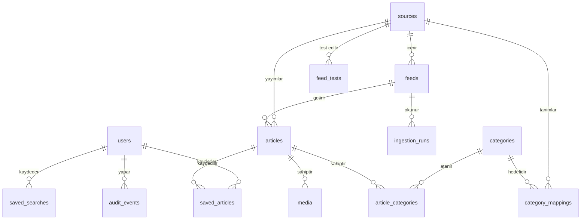

# Veri Modeli

## 1. Amaç

Bu doküman, PostgreSQL tablolarını, Elasticsearch belge yapısını, MinIO'daki dosya düzenini ve veritabanı kullanıcılarını tanımlar. Kurallar ADR-0015'te, veri depolarının rolleri ve yaşam döngüsü ADR-0011'de, audit log tasarımı ADR-0016'dadır.

Genel kurallar (ADR-0015):

- Birincil anahtarlar `uuid` türündedir ve varsayılan değeri `uuidv7()` fonksiyonuyla üretilir.
- Zaman alanları `timestamptz` türündedir ve UTC olarak saklanır.
- Her tabloda `created_at` ve `updated_at` bulunur; ilişki tablolarında yalnızca `created_at` bulunur.
- Sabit değer kümeleri `text` türünde ve `CHECK` kısıtıyla tutulur.
- Yöneticilerin düzenlediği tablolarda iyimser kilitleme için `version` sütunu bulunur.

## 2. Tablolar Arası İlişkiler

`outbox_events` ve `audit_events` tablolarındaki haber ve hedef kimlikleri bilinçli olarak yabancı anahtar değildir (bkz. 3.10 ve 3.13).

## 3. PostgreSQL Tabloları

### 3.1 `users` (modül: identity)

| Sütun | Tür | Kural | Açıklama |
|---|---|---|---|
| `id` | `uuid` | Birincil anahtar | |
| `keycloak_sub` | `text` | Zorunlu, benzersiz | Keycloak'taki değişmeyen kullanıcı kimliği; eşleştirme bununla yapılır (R-15) |
| `email` | `text` | Zorunlu | Token'dan alınır; eşleştirmede kullanılmaz |
| `display_name` | `text` | | Token'dan alınan ad |
| `role` | `text` | Zorunlu; `USER`, `ADMIN` | |
| `status` | `text` | Zorunlu; `PENDING`, `ACTIVE`, `PASSIVE`, `REJECTED` | |
| `last_session_id` | `text` | | Son kaydedilen Keycloak oturum kimliği (ADR-0016) |
| `version` | `integer` | Zorunlu | |
| `created_at`, `updated_at` | `timestamptz` | Zorunlu | |

- İlk istekte kayıt yoksa `PENDING` durumunda oluşturulur; aynı anda gelen iki istekte ikinci ekleme benzersizlik kısıtına takılır ve atlanır.
- `email`, `display_name` ve `last_session_id` uygulama tarafından, yalnızca değer değiştiğinde ve sürüm kontrolü yapılmadan güncellenir (ADR-0015).

### 3.2 `sources` (modül: ingestion)

| Sütun | Tür | Kural | Açıklama |
|---|---|---|---|
| `id` | `uuid` | Birincil anahtar | |
| `code` | `text` | Zorunlu, benzersiz | Değişmeyen kod: `TRT`, `NTV`, `CNNTURK`, `GLOBALVOICES`, `NYT` |
| `name` | `text` | Zorunlu, benzersiz | Görünen ad |
| `homepage_url` | `text` | Zorunlu | Atıfta kullanılan ana sayfa |
| `reader_type` | `text` | Zorunlu; `RSS`, `ATOM`, `NYT_TOP_STORIES` | Beslemelerin ayrıştırıldığı okuyucu |
| `language` | `text` | Zorunlu; `tr`, `en` | |
| `request_interval_seconds` | `integer` | Zorunlu, sıfırdan büyük | İki istek arasında beklenecek süre |
| `daily_request_limit` | `integer` | Boş olabilir, sıfırdan büyük | Son 24 saatteki en fazla istek sayısı; boşsa sınır yok (NYT için 400) |
| `field_mapping` | `jsonb` | | Alanların nereden okunacağı |
| `license` | `text` | | Kullanım hakkının dayanağı |
| `attribution_text` | `text` | | Arayüzde gösterilecek atıf metni |
| `purge_requested_at` | `timestamptz` | | Kaynak içeriğinin silinmesi istendiğinde dolar; işçi silmeyi tamamladığında boşaltır (FG-YP-14) |
| `enabled` | `boolean` | Zorunlu, varsayılan `true` | |
| `version` | `integer` | Zorunlu | |
| `created_at`, `updated_at` | `timestamptz` | Zorunlu | |

- API anahtarları bu tabloda tutulmaz; kaynağın `code` değerine göre yapılandırmadan okunur.

### 3.3 `feeds` (modül: ingestion)

| Sütun | Tür | Kural | Açıklama |
|---|---|---|---|
| `id` | `uuid` | Birincil anahtar | |
| `source_id` | `uuid` | Zorunlu, `sources` | |
| `name` | `text` | Zorunlu | |
| `url` | `text` | Zorunlu, benzersiz | Besleme adresi; anahtar içermez |
| `default_category_id` | `uuid` | `categories`, boş olabilir | Besleme düzeyindeki kategori |
| `use_item_categories` | `boolean` | Zorunlu | Haber düzeyinde eşleme uygulanır mı |
| `fetch_interval_minutes` | `integer` | Zorunlu, varsayılan 15 | |
| `next_fetch_at` | `timestamptz` | Zorunlu | Bir sonraki okuma zamanı |
| `etag`, `last_modified` | `text` | | Koşullu istek için |
| `consecutive_failures` | `integer` | Zorunlu, varsayılan 0 | |
| `last_success_at` | `timestamptz` | | |
| `last_error` | `text` | | |
| `enabled` | `boolean` | Zorunlu, varsayılan `true` | |
| `disabled_reason` | `text` | `MANUAL`, `AUTO` | |
| `version` | `integer` | Zorunlu | |
| `created_at`, `updated_at` | `timestamptz` | Zorunlu | |

- Benzersiz: `(source_id, name)`.
- Kısıt: `enabled` `false` ise `disabled_reason` dolu, `true` ise boş olmalıdır.
- İndeks: `(enabled, next_fetch_at)`.
- Zamanlama ve sağlık alanları işçi tarafından, sürüm kontrolü yapılmadan güncellenir (ADR-0015).
- İşçi, kaynağı devre dışı olan beslemeleri okumaz.

### 3.4 `categories` (modül: ingestion)

| Sütun | Tür | Kural | Açıklama |
|---|---|---|---|
| `id` | `uuid` | Birincil anahtar | |
| `code` | `text` | Zorunlu, benzersiz | |
| `kind` | `text` | Zorunlu; `TOPIC`, `TEMPORAL` | Konu kategorisi mi, zaman etiketi mi |
| `sort_order` | `integer` | Zorunlu | Arayüzdeki sıra |
| `window_hours` | `integer` | Boş olabilir, sıfırdan büyük | Doluysa kategori yalnızca bu süre içinde yayımlanan haberleri gösterir |
| `created_at`, `updated_at` | `timestamptz` | Zorunlu | |

Başlangıç verisi:

| `code` | Kategori | `kind` | `window_hours` |
|---|---|---|---|
| `GENERAL` | Gündem | `TOPIC` | |
| `WORLD` | Dünya | `TOPIC` | |
| `ECONOMY` | Ekonomi | `TOPIC` | |
| `SPORTS` | Spor | `TOPIC` | |
| `HEALTH` | Sağlık | `TOPIC` | |
| `SCIENCE_TECH` | Bilim ve Teknoloji | `TOPIC` | |
| `CULTURE_ARTS` | Kültür ve Sanat | `TOPIC` | |
| `LIFESTYLE` | Yaşam | `TOPIC` | |
| `BREAKING` | Son Dakika | `TEMPORAL` | 6 |
| `OTHER` | Diğer | `TOPIC` | |

- Kategorilerin görünen adları tabloda değil, arayüzün dil dosyalarında tutulur (FOG-31).
- Hiçbir `TOPIC` kategorisi atanamayan haber `OTHER` kategorisine atanır (FG-VT-13).

### 3.5 `category_mappings` (modül: ingestion)

| Sütun | Tür | Kural | Açıklama |
|---|---|---|---|
| `id` | `uuid` | Birincil anahtar | |
| `source_id` | `uuid` | Zorunlu, `sources` | |
| `source_category` | `text` | Zorunlu | Kaynağın kategori değeri; normalleştirilmiş olarak saklanır |
| `category_id` | `uuid` | Zorunlu, `categories` | |
| `created_at`, `updated_at` | `timestamptz` | Zorunlu | |

- Benzersiz: `(source_id, source_category)`.
- Normalleştirme: Baştaki ve sondaki boşluklar atılır, değer kaynağın dilinin kurallarıyla küçük harfe çevrilir (Türkçe kaynaklarda "I" → "ı", "İ" → "i").
- Eşlemeler veritabanı geçiş betikleriyle eklenir.

### 3.6 `articles` (modül: ingestion)

| Sütun | Tür | Kural | Açıklama |
|---|---|---|---|
| `id` | `uuid` | Birincil anahtar | Elasticsearch belge kimliğiyle aynı |
| `source_id` | `uuid` | Zorunlu, `sources` | |
| `feed_id` | `uuid` | `feeds` | Haberi ilk getiren besleme |
| `external_id` | `text` | Zorunlu | Kaynağın verdiği kimlik |
| `url` | `text` | Zorunlu | Özgün habere bağlantı; değiştirilmez |
| `normalized_url` | `text` | Zorunlu | Tekrar kontrolü için |
| `title` | `text` | Zorunlu | |
| `summary` | `text` | | |
| `content` | `text` | | Temizlenmiş HTML; `` etiketleri çıkarılmış |
| `author` | `text` | | |
| `language` | `text` | Zorunlu; `tr`, `en` | |
| `item_type` | `text` | Zorunlu; `ARTICLE`, `VIDEO`, `GALLERY` | |
| `published_at` | `timestamptz` | Zorunlu | Kaynak vermezse toplanma zamanı |
| `fetched_at` | `timestamptz` | Zorunlu | |
| `lifecycle_state` | `text` | Zorunlu; `HOT`, `WARM`, `COLD` | |
| `group_id` | `uuid` | Boş olabilir | Kaynaklar arası grup; başka bir tabloya bağlı değildir |
| `hidden` | `boolean` | Zorunlu, varsayılan `false` | |
| `hidden_reason` | `text` | | |
| `hidden_at` | `timestamptz` | | |
| `hidden_by` | `uuid` | `users` | |
| `created_at`, `updated_at` | `timestamptz` | Zorunlu | |

- Benzersiz: `(source_id, external_id)` ve `(source_id, normalized_url)` (FG-VT-04). Tekrar eden haber görmezden gelinir.
- Kısıt: `hidden` `true` ise `hidden_at` ve `hidden_by` dolu olmalıdır.
- İndeksler: `(lifecycle_state, published_at)`, `(source_id, published_at)`, `fetched_at`.
- Tablo bölümlenmez (ADR-0015).
- Yaşam döngüsü durumu, işçideki günlük işle `published_at` değerine göre güncellenir: 30 günden yeni `HOT`, 30 gün ile 1 yıl arası `WARM`, 1 yıldan eski `COLD`.

### 3.7 `article_categories` (modül: ingestion)

| Sütun | Tür | Kural | Açıklama |
|---|---|---|---|
| `article_id` | `uuid` | `articles` | |
| `category_id` | `uuid` | `categories` | |
| `mapping_level` | `text` | Zorunlu; `FEED`, `ITEM` | Kategorinin hangi düzeyde atandığı |
| `created_at` | `timestamptz` | Zorunlu | |

- Birincil anahtar: `(article_id, category_id)`.

### 3.8 `media` (modül: ingestion)

| Sütun | Tür | Kural | Açıklama |
|---|---|---|---|
| `id` | `uuid` | Birincil anahtar | |
| `article_id` | `uuid` | Zorunlu, `articles` | |
| `media_type` | `text` | Zorunlu; `IMAGE`, `VIDEO` | Şimdilik yalnızca `IMAGE` |
| `position` | `integer` | Zorunlu | 0 ana görsel |
| `source_url` | `text` | Zorunlu | Kaynaktaki adres |
| `status` | `text` | Zorunlu; `PENDING`, `DOWNLOADED`, `FAILED` | |
| `attempts` | `integer` | Zorunlu, varsayılan 0 | |
| `next_attempt_at` | `timestamptz` | | |
| `last_error` | `text` | | |
| `storage_key` | `text` | | MinIO'daki anahtar; indirildikten sonra dolar |
| `content_type` | `text` | | |
| `size_bytes` | `bigint` | | |
| `width`, `height` | `integer` | | |
| `caption` | `text` | | |
| `credit` | `text` | | Fotoğrafçı veya lisans bilgisi |
| `created_at`, `updated_at` | `timestamptz` | Zorunlu | |

- Benzersiz: `(article_id, source_url)`.
- İndeks: `(status, next_attempt_at)`.
- Tablo aynı zamanda görsel indirme kuyruğudur (ADR-0013): `PENDING` durumundaki ve deneme zamanı gelmiş kayıtlar indirilir; belirli sayıda başarısız denemeden sonra `FAILED` olur.

### 3.9 `ingestion_runs` (modül: ingestion)

| Sütun | Tür | Kural | Açıklama |
|---|---|---|---|
| `id` | `uuid` | Birincil anahtar | |
| `feed_id` | `uuid` | Zorunlu, `feeds` | |
| `trigger` | `text` | Zorunlu; `SCHEDULED`, `MANUAL` | |
| `status` | `text` | Zorunlu; `RUNNING`, `SUCCEEDED`, `NOT_MODIFIED`, `FAILED` | |
| `started_at` | `timestamptz` | Zorunlu | |
| `finished_at` | `timestamptz` | | |
| `http_status` | `integer` | | |
| `final_url` | `text` | | Yönlendirmeler takip edildikten sonra varılan adres |
| `items_received` | `integer` | | |
| `items_new` | `integer` | | |
| `items_duplicate` | `integer` | | |
| `items_failed` | `integer` | | Bozuk olduğu için atlanan haber sayısı |
| `error_message` | `text` | | |
| `created_at`, `updated_at` | `timestamptz` | Zorunlu | |

- İndeks: `(feed_id, started_at)`.
- Kaynakların günlük istek sınırı, bu tablodaki son 24 saatlik kayıtlardan hesaplanır.
- Saklama süresi önerisi 180 gündür; kesin süre veri büyümesi analizinde belirlenecektir.

### 3.10 `outbox_events` (modül: search)

| Sütun | Tür | Kural | Açıklama |
|---|---|---|---|
| `id` | `uuid` | Birincil anahtar | İşleme sırasını da belirler |
| `article_id` | `uuid` | Zorunlu | Yabancı anahtar değildir |
| `operation` | `text` | Zorunlu; `INDEX`, `DELETE` | |
| `status` | `text` | Zorunlu; `PENDING`, `PROCESSED` | |
| `attempts` | `integer` | Zorunlu, varsayılan 0 | |
| `next_attempt_at` | `timestamptz` | | |
| `last_error` | `text` | | |
| `processed_at` | `timestamptz` | | |
| `created_at`, `updated_at` | `timestamptz` | Zorunlu | |

- İndeks: `status = 'PENDING'` olan satırları kapsayan, `next_attempt_at` üzerinde kısmi indeks.
- `article_id` yabancı anahtar değildir: Silinen bir haberin `DELETE` kaydının, haber silindikten sonra da var olabilmesi gerekir.
- Kayıt haberin içeriğini taşımaz; işleyen iş haberin PostgreSQL'deki güncel halini okur. Silinmiş bir habere ait `INDEX` kaydı atlanır.
- Haber gizlendiğinde `DELETE`, gizleme geri alındığında `INDEX` kaydı oluşturulur.
- Kayıtlardan vazgeçilmez; başarısız aktarımlar artan aralıklarla yeniden denenir. İşlenmiş kayıtlar belirli bir süre sonra (öneri: 7 gün) silinir.

### 3.11 `saved_articles` (modül: library)

| Sütun | Tür | Kural | Açıklama |
|---|---|---|---|
| `user_id` | `uuid` | `users` | |
| `article_id` | `uuid` | `articles` | |
| `created_at` | `timestamptz` | Zorunlu | |

- Birincil anahtar: `(user_id, article_id)`.
- İndeks: `(user_id, created_at)`.

### 3.12 `saved_searches` (modül: library)

| Sütun | Tür | Kural | Açıklama |
|---|---|---|---|
| `id` | `uuid` | Birincil anahtar | |
| `user_id` | `uuid` | Zorunlu, `users` | |
| `name` | `text` | Zorunlu | |
| `query` | `text` | | |
| `filters` | `jsonb` | | Kaynak, dil, kategori, tarih aralığı, sıralama |
| `created_at`, `updated_at` | `timestamptz` | Zorunlu | |

- Benzersiz: `(user_id, name)`.
- Tarih filtresi göreli olarak saklanır (örneğin "son 7 gün").

### 3.13 `audit_events` (modül: audit)

| Sütun | Tür | Kural | Açıklama |
|---|---|---|---|
| `id` | `uuid` | | |
| `occurred_at` | `timestamptz` | Zorunlu | Bölümleme anahtarı |
| `actor_type` | `text` | Zorunlu; `USER`, `SYSTEM` | |
| `actor_user_id` | `uuid` | | Yabancı anahtar değildir |
| `action` | `text` | Zorunlu | İşlem kodu |
| `target_type` | `text` | | |
| `target_id` | `uuid` | | |
| `result` | `text` | Zorunlu; `SUCCESS`, `FAILURE` | |
| `request_id` | `text` | | |
| `ip_address` | `inet` | | |
| `details` | `jsonb` | | Yalnızca işleme göre önceden tanımlanmış alanlar |

- Birincil anahtar: `(id, occurred_at)`.
- Tablo `occurred_at` alanına göre aylara bölümlenir; bölümler geçiş betikleriyle 2028 sonuna kadar oluşturulur ve bir varsayılan bölüm bulunur.
- İndeksler: `occurred_at`, `(actor_user_id, occurred_at)`, `(action, occurred_at)`, `(target_type, target_id)`.
- Tablodaki güncelleme ve silmeler bir tetikleyiciyle reddedilir.
- Kayıtlar başka tablolara yabancı anahtarla bağlanmaz: Bölümlenmiş tabloda yabancı anahtarlar yazma maliyetini artırır ve audit kaydı, bağlı olduğu nesne değişse de olduğu gibi kalmalıdır.
- Tabloda `updated_at` bulunmaz; kayıtlar hiç güncellenmez.

### 3.14 `feed_tests` (modül: ingestion)

| Sütun | Tür | Kural | Açıklama |
|---|---|---|---|
| `id` | `uuid` | Birincil anahtar | |
| `source_id` | `uuid` | Zorunlu, `sources` | Ayarları kullanılacak kaynak |
| `url` | `text` | Zorunlu | Test edilecek adres |
| `requested_by` | `uuid` | Zorunlu, `users` | Testi isteyen yönetici |
| `status` | `text` | Zorunlu; `PENDING`, `SUCCEEDED`, `FAILED` | |
| `result` | `jsonb` | | HTTP durum kodu, bulunan haber sayısı ve örnek haber |
| `error` | `text` | | |
| `completed_at` | `timestamptz` | | |
| `created_at`, `updated_at` | `timestamptz` | Zorunlu | |

- İndeks: `status = 'PENDING'` olan satırları kapsayan, `created_at` üzerinde kısmi indeks.
- Test sonuçları kalıcı bir değer taşımadığından kısa süre sonra (öneri: 1 gün) silinir.

## 4. Silme Davranışları

| Silinen | Etki |
|---|---|
| Haber | `article_categories`, `media` ve `saved_articles` satırları da silinir. Haberlerin silindiği tek yol kaynak içeriğinin silinmesidir (FG-YP-14): Önce MinIO'daki dosyalar, ardından satırlar silinir; Elasticsearch için `DELETE` outbox kayıtları aynı işlemde yazılır. |
| Kullanıcı, kaynak, besleme, kategori | Silinmez; kullanıcıların durumu değiştirilir, kaynaklar ve beslemeler devre dışı bırakılır. Bu tablolara bağlanan yabancı anahtarlar silmeyi engelleyecek şekilde tanımlanır. |

## 5. Elasticsearch

### 5.1 İndeksler

- Haberler, yayın tarihinin ayına göre aylık indekslerde tutulur. İndeks adı ayın ilk gününü içerir: `articles-g1-2026.11.01`. `g1`, indeks neslini gösterir (bkz. 5.4).
- İndekslerde `index.lifecycle.parse_origination_date` ayarı açıktır; indeksin yaşı, adındaki tarihten hesaplanır. Böylece geçmiş tarihli haberlerin yüklendiği indeksler de doğru yaşta kabul edilir.
- Aramalar bütün aylık indeksleri kapsayan `articles` takma adı (alias) üzerinden yapılır.

### 5.2 Belge alanları

| Alan | Tür | Açıklama |
|---|---|---|
| belge kimliği | | Haberin PostgreSQL'deki `id` değeri |
| `source_code` | `keyword` | Kaynak filtresi için |
| `language` | `keyword` | Dil filtresi için |
| `item_type` | `keyword` | |
| `categories` | `keyword` (çok değerli) | Kategori kodları |
| `published_at` | `date` | |
| `group_id` | `keyword` | Gruplanmış haberlerin tek sonuç olarak gösterilmesi için |
| `title_tr`, `summary_tr`, `content_tr` | `text`, Türkçe analiz | Yalnızca Türkçe haberlerde dolar |
| `title_en`, `summary_en`, `content_en` | `text`, İngilizce analiz | Yalnızca İngilizce haberlerde dolar |

- Türkçe ve İngilizce alanlarda Elasticsearch'ün yerleşik `turkish` ve `english` dil analizörleri kullanılır. Türkçe analizörün sonuçları kurulum sırasında örnek haberlerle doğrulanacaktır.
- Arama, iki dilin alanlarında birlikte yapılır. Alan ağırlıkları başlık, özet ve tam metin sırasıyla azalır (FG-AR-01); kesin değerler arama geliştirilirken belirlenecektir.
- Gizlenen haberler indekste bulunmaz.
- Görseller, kaynak adı ve atıf bilgisi indekste tutulmaz; arama sonuçlarındaki haberler için PostgreSQL'den tek bir toplu sorguyla alınır.

### 5.3 Yaşam döngüsü politikası

| Aşama | İndeks yaşı | İşlem |
|---|---|---|
| Sıcak | 0 – 60 gün | Yok |
| Ilık | 60 gün sonra | Birleştirme (force merge) |
| Soğuk | 395 gün sonra | Düşük öncelik |

- İndeks yaşı ayın ilk gününden hesaplandığından, aşama süreleri bir aylık indeksteki **bütün** haberlerin ilgili yaşa ulaştığı ana göre seçilmiştir: 60 günlük bir indeksteki en yeni haber 30 günlük, 395 günlük bir indeksteki en yeni haber 1 yıllıktır. Böylece Elasticsearch'teki aşamalar, PostgreSQL'deki durumlardan önce değişmez.
- İndeksler hiçbir aşamada salt okunur yapılmaz (ADR-0015).
- Soğuk haberlerin sıralamada geriye düşmesi, arama sorgusunda yayın tarihi 1 yıldan eski haberlere düşük ağırlık verilerek sağlanır.

### 5.4 Yeniden indeksleme

Tam yeniden indeksleme (ADR-0012), yeni bir nesil numarasıyla (`g2`) yeni indekslere yapılır. İşlem tamamlandığında `articles` takma adı yeni indekslere taşınır ve eski nesil silinir. Böylece yeniden indeksleme sırasında aramalar kesintisiz devam eder.

## 6. MinIO

- Görseller özel (herkese açık olmayan) bir kovada (bucket) tutulur.
- Anahtar biçimi: `articles/{article_id}/{media_id}`. Bir haberin bütün dosyaları tek bir ön ek altında bulunduğundan, satırlara bakmadan silinebilir.
- Görseller tarayıcıya MinIO'dan doğrudan değil, Spring Boot API üzerinden ve imzalı adreslerle sunulur (`06-api-sozlesmesi.md`, 4.4).

## 7. Kullanıcılar ve Yetkiler

### 7.1 PostgreSQL

| Kullanıcı | Veritabanı | Yetkiler |
|---|---|---|
| `news_owner` | Uygulama veritabanı | Tabloların sahibi. Geçiş betikleri bu kullanıcıyla çalışır; betikleri Spring Boot API açılırken çalıştırır (ADR-0018). Uygulamaların normal işlemleri bu kullanıcıyla yapılmaz. |
| `news_app` | Uygulama veritabanı | Spring Boot API. Tablolarda okuma, ekleme, güncelleme ve silme; `audit_events` tablosunda yalnızca okuma ve ekleme. |
| `news_worker` | Uygulama veritabanı | Python işçisi. Yalnızca ihtiyaç duyduğu tablolarda ve işlemlerde yetki; `audit_events` tablosunda yalnızca ekleme. Kullanıcı tablolarına (`users`, `saved_articles`, `saved_searches`) erişimi yoktur. |
| `keycloak` | Ayrı `keycloak` veritabanı | Yalnızca kendi veritabanına erişir. |

- Veritabanı şemasının sahibi tektir; geçiş betikleri tek bir yerde tutulur ve Python işçisi şemayı değiştirmez (ADR-0017).
- Uygulamalar ve Keycloak aynı PostgreSQL sunucusunu kullanır, ancak birbirlerinin yetki alanlarının dışındaki verilere erişemez.

### 7.2 Elasticsearch ve MinIO

| Depo | Spring Boot API | Python işçisi |
|---|---|---|
| Elasticsearch | Yalnızca okuma | Okuma ve yazma; indeks şablonlarının ve yaşam döngüsü politikasının oluşturulması |
| MinIO | Yalnızca okuma | Okuma, yazma ve silme |

### 7.3 Yedekleme kapsamı

PostgreSQL (uygulama ve Keycloak veritabanları) ve MinIO yedeklenir. Elasticsearch, PostgreSQL'den her zaman yeniden oluşturulabildiğinden yedeklenmez. Yedekleme yöntemi ayrıca belirlenecektir.

## 8. Bilinen Sınırlamalar ve Açık Konular

- Sonradan eklenen kategori eşlemeleri yalnızca yeni haberlere uygulanır; önceden `OTHER` kategorisine atanmış haberler yeniden kategorilenmez. Gerekirse ileride bir yeniden kategorileme işi eklenebilir.
- Kaynaklar arası gruplama (FG-VT-11) yöntemi henüz seçilmemiştir; seçilen yöntem `articles` tablosuna ek bir sütun gerektirebilir.
- `ingestion_runs`, işlenmiş `outbox_events` kayıtları ve `audit_events` için saklama süreleri veri büyümesi analizinde belirlenecektir.