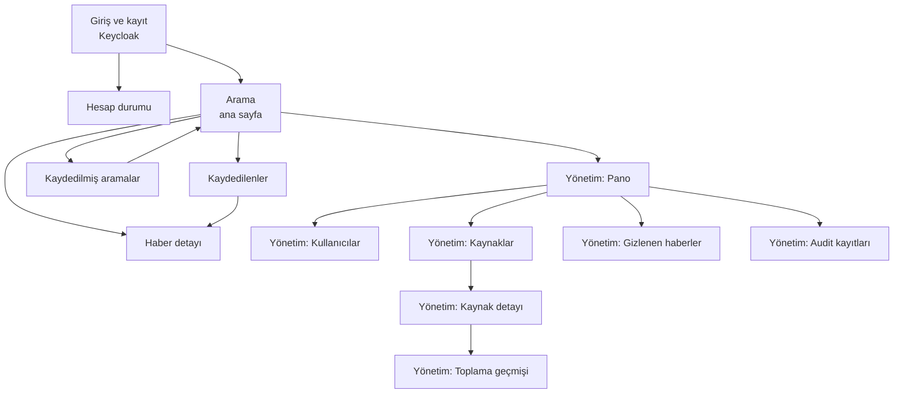

# Ekran Akışları

## 1. Amaç

Bu doküman, arayüzün ekranlarını, ekranlar arasındaki geçişleri ve uçtan uca kullanıcı akışlarını tanımlar. Ekranların görsel tasarımı frontend geliştirilirken shadcn/ui bileşenleriyle belirlenecektir; bu doküman ekranların içeriğini ve davranışını anlatır. Kullanılan uç noktalar `06-api-sozlesmesi.md` dokümanındadır.

## 2. Genel Kurallar

- **Dil:** Arayüz Türkçedir; bütün metinler dil dosyalarında tutulur (FOG-31). Haberlerin içeriği kaynağın dilinde gösterilir. Hata mesajları, API'nin döndüğü hata kodlarından dil dosyalarıyla üretilir (FOG-27).
- **Tarihler:** Europe/Istanbul saatiyle gösterilir (FOG-33).
- **Ekran boyutları:** 360 piksel ile 1920 piksel arasındaki genişliklerde kullanılabilir olmalıdır (FOG-34).
- **Erişilebilirlik:** WCAG 2.2 AA düzeyi (FOG-30). Bütün işlemler klavyeyle yapılabilir; görsellerin alternatif metni, görselin altyazısı veya haberin başlığıdır. Görsel, başlığın hemen yanında yalnızca süs olarak duruyorsa (arama sonuçları) alternatif metni boştur; ekran okuyucu başlığı iki kez okumaz.
- **Yetki:** Yönetim paneli menüsü yalnızca `ADMIN` rolündeki kullanıcılara gösterilir. Bu yalnızca bir kolaylıktır; yetki kontrolü backend'de yapılır.
- **Atıf:**
  - Her haberde kaynağın adı ve özgün habere bağlantı gösterilir (FG-AR-07).
  - NYT haberinin göründüğü her ekranda (arama sonuçları, haber detayı, kaydedilenler), `https://developer.nytimes.com` adresine bağlantı veren NYT API logosu gösterilir. Logo, NYT'nin verdiği boyutlardan biriyle ve değiştirilmeden kullanılır; ekranın en belirgin öğesi olmaz (ADR-0009).
  - Global Voices haberlerinin detayında lisans bilgisi gösterilir.
- **Özgün habere bağlantılar:** Yeni sekmede ve `rel="noopener noreferrer"` ile açılır. NYT sayfaları uygulamanın içinde çerçeve olarak gösterilmez (ADR-0009).
- **Görseller:** Görseli olmayan veya görseli indirilmemiş haberlerde yer tutucu gösterilir (FG-AR-08).
- **Ortak hata davranışları:**

| API yanıtı | Arayüzün davranışı |
|---|---|
| `401` | Kullanıcı Keycloak'ın giriş sayfasına yönlendirilir. |
| `403` ve kod `USER_PENDING_APPROVAL`, `USER_REJECTED` veya `USER_PASSIVE` | Hesap durumu ekranına geçilir. Kullanıcı oturum ortasında pasif yapılmışsa da bu ekran gösterilir. |
| `403` ve kod `FORBIDDEN` | "Bu işlem için yetkiniz yok" mesajı |
| `404` | Bulunamadı ekranı |
| `409` ve kod `VERSION_CONFLICT` | "Bu kayıt siz düzenlerken değiştirildi" uyarısı ve kaydı yenileme seçeneği |
| `429` | "Çok fazla istek gönderildi, lütfen biraz bekleyin" mesajı |
| `500` veya ağ hatası | Genel hata mesajı ve yeniden deneme seçeneği |

## 3. Gezinme Haritası

- **Üst menü:** Arama, Kaydedilenler, Kaydedilmiş aramalar ve yalnızca yöneticilere görünen Yönetim.
- **Kullanıcı menüsü:** Kullanıcının adı ve Çıkış. Çıkışta Keycloak oturumu da sonlandırılır (ADR-0014).
- **Yönetim paneli:** Kendi yan menüsüyle Pano, Kullanıcılar, Kaynaklar, Toplama geçmişi, Gizlenen haberler ve Audit kayıtları.

## 4. Akışlar

Bu akışlar, uçtan uca testlerin senaryolarının temelidir.

### 4.1 Yeni kullanıcının kaydolması ve onaylanması

1. Kullanıcı uygulamayı açar; giriş yapmamış olduğu için Keycloak'ın giriş sayfasına yönlendirilir.
2. "Kayıt ol" bağlantısıyla kayıt formunu doldurur.
3. Keycloak bir doğrulama e-postası gönderir; kullanıcı e-postadaki bağlantıya tıklar.
4. Kullanıcı uygulamaya döner. İlk isteğinde kullanıcı kaydı "onay bekliyor" durumunda oluşturulur; hesap durumu ekranında "Hesabınız yönetici onayı bekliyor" mesajını görür.
5. Yönetici, Kullanıcılar ekranında onay bekleyenleri filtreler ve kullanıcıyı onaylar.
6. Kullanıcı hesap durumu ekranındaki "Yeniden kontrol et" butonuna bastığında veya sayfayı yenilediğinde arama ekranına geçer.

### 4.2 Arama ve haber kaydetme

1. Kullanıcı arama ekranında bir ifade yazar.
2. Sonuçlar ilgililiğe göre sıralanmış olarak gelir; eşleşen kelimeler vurgulanır.
3. Kullanıcı kaynak ve kategori filtrelerini uygular; sonuçlar güncellenir ve filtreler adres çubuğuna yansır.
4. Bir sonuca tıklayarak haber detayına geçer.
5. Kaydet düğmesine (yer imi) basar; düğme basılı duruma geçer. Haberi detaya geçmeden, sonuç kartındaki aynı düğmeyle de kaydedebilir.
6. Kaydedilenler ekranında haberi görür.

### 4.3 Yöneticinin yeni bir kaynak eklemesi

1. Yönetici Kaynaklar ekranında "Kaynak ekle" butonuna basar ve formu doldurur. Kaynak devre dışı olarak kaydedilir.
2. Kaynak detayında "Besleme ekle" ile besleme adresini girer ve "Dene" butonuna basar.
3. Test sonucu birkaç saniye içinde gösterilir: bulunan haber sayısı ve örnek bir haber.
4. Sonuç uygunsa beslemeyi kaydeder.
5. Kaynağı etkinleştirir.
6. Toplama geçmişinde beslemenin ilk okumasını görür.

### 4.4 Haber gizleme ve gizlemeyi geri alma

1. Yönetici bir haberin detayında "Gizle" butonuna basar.
2. Açılan pencerede gerekçe yazar ve onaylar. Haber birkaç saniye içinde aramadan kalkar (ADR-0012).
3. Daha sonra Gizlenen haberler ekranında haberi bulur ve "Gizlemeyi geri al" butonuna basar.
4. Haber birkaç saniye içinde aramada yeniden görünür.

### 4.5 Kaynak içeriğinin silinmesi

1. Yönetici kaynak detayında kaynağı devre dışı bırakır.
2. "İçeriği sil" butonuna basar. Açılan pencere işlemin geri alınamayacağını açıklar ve kaynağın kodunun yazılmasını ister.
3. Kodu yazıp onaylar. Kaynak detayında "İçerik siliniyor" durumu gösterilir.
4. Silme tamamlandığında bu durum kalkar ve kaynağın haber sayısı sıfır olur.

### 4.6 Kullanıcının pasif yapılması

1. Yönetici Kullanıcılar ekranında bir kullanıcının durumunu pasif yapar.
2. O kullanıcının bir sonraki isteği `403 USER_PASSIVE` ile reddedilir.
3. Kullanıcının arayüzü hesap durumu ekranına geçer ve "Hesabınız pasif durumdadır" mesajını gösterir.

## 5. Ekranlar

### 5.1 Kullanıcı tarafı

#### Giriş ve kayıt

- Keycloak'ın kendi giriş, kayıt ve e-posta doğrulama sayfaları, varsayılan görünümleriyle ve Türkçe dil seçeneğiyle kullanılır. Keycloak'ın Türkçe dil desteği kurulum sırasında doğrulanacaktır.
- Bu sayfaların uygulamanın görünümüne uyarlanması (Keycloak teması) kapsam dışıdır; gerekirse sonradan yapılabilir.

#### Hesap durumu

- **Amaç:** Durumu aktif olmayan kullanıcıya durumunu bildirmek.
- **İçerik:** Durumuna göre mesaj: onay bekliyor, reddedildi veya pasif. Onay bekleyen kullanıcı için "Yeniden kontrol et" butonu. Çıkış butonu.
- **Uç nokta:** `GET /me`

#### Arama (ana sayfa)

- **Amaç:** Haberlerde arama, filtreleme ve göz atma (FG-AR-01–05, 12).
- **İçerik:**
  - Arama kutusu
  - Filtreler: kaynak (çoklu seçim), dil, kategori (çoklu seçim), tarih aralığı
  - Son Dakika için hızlı erişim düğmesi
  - Sıralama: İlgililik veya En yeni. Arama kutusu boşken yalnızca En yeni.
  - Sonuç kartları: görsel, başlık, vurgulanmış özet, kaynak adı, yayın tarihi, "N kaynak daha" bilgisi ve Kaydet düğmesi. Görsel başlığın hemen yanında olduğu için alternatif metni boştur; ekran okuyucu başlığı iki kez okumaz. Son 24 saatteki haberin zamanı göreli ("3 saat önce"), daha eskisininki tarih ve saattir.
  - Sayfalama: önceki/sonraki ve sayfa numaraları (`1 2 3 4 5 … 150`; her sayfada yedi yuva, bağlantılar kaymaz). Dar ekranda numaralar yerine "Sayfa 2 / 150". Listenin üstünde de kısa bir sayfa geçişi (`‹ 2 / 150 ›`) bulunur: yeni sayfaya geçince sayfanın başına dönülür, önceki/sonraki için en alta inmek gerekmez.
  - "Bu aramayı kaydet" butonu (İ-30)
- **Davranışlar:**
  - Arama kutusu boşken en yeni haberler listelenir.
  - Arama ifadesi, filtreler, sıralama ve sayfa adres çubuğunda tutulur; geri butonu ve sayfa yenileme aramayı korur.
  - Vurgulamada yalnızca `<mark>` etiketi işlenir.
  - 10.000 sonuç sınırının ötesindeki sayfalar sunulmaz; kullanıcıya aramayı daraltması önerilir.
  - Kaydet düğmesi bir aç/kapa düğmesidir: basılıysa haber kayıtlıdır, basınca kayıttan çıkar. Durumu ekran okuyucuya `aria-pressed` ile bildirilir; adı durumla değişmez ("Kaydet, basılı"), listelerde adında haberin başlığı bulunur. Basınca yeni durum hemen gösterilir; istek başarısız olursa düğme eski durumuna döner ve hata mesajı gösterilir. Arama yeniden yapılmaz.
- **Boş durumlar:** Sonuç yoksa "Aramanızla eşleşen haber bulunamadı" mesajı ve filtreleri temizleme seçeneği.
- **Uç noktalar:** `GET /articles`, `GET /sources`, `GET /categories`, `PUT` ve `DELETE /me/saved-articles/{articleId}`, `POST /me/saved-searches`

#### Haber detayı

- **Amaç:** Haberin tamamını göstermek (FG-AR-06, 07, 10).
- **İçerik:**
  - Başlık, yayın tarihi, yazar ve kategoriler
  - Görseller; altyazı ve fotoğrafçı bilgisiyle
  - Tam metin veya, tam metin yoksa, özet
  - Kaynak adı, atıf bilgisi ve gerekiyorsa logo
  - "Haberin tamamını kaynağında oku" bağlantısı
  - "Aynı haberi veren diğer kaynaklar" listesi
  - Kaydet düğmesi (arama ekranındakiyle aynı aç/kapa düğmesi)
  - Yalnızca yöneticilere: "Gizle" butonu
- **Davranışlar:**
  - Gizleme butonu, gerekçe alanı zorunlu olan bir onay penceresi açar.
  - "Aramaya dön" bağlantısı, gelinen aramaya filtreleri ve sayfasıyla döner; detay doğrudan açıldıysa ana sayfaya gider. Detaya Kaydedilenler'den gelindiyse bağlantı "Kaydedilenlere dön" olur ve aynı sayfaya döner.
  - Tam metin, işçinin temizlediği HTML'dir ve tarayıcıda ikinci kez temizlenir (ADR-0018, 6. bölüm); metindeki bağlantılar yeni sekmede açılır.
  - Haber yeni kaydedildiyse ve metni arama indeksine henüz aktarılmadıysa (birkaç saniye) "metin henüz hazır değil" mesajı gösterilir. Arama indeksine ulaşılamıyorsa metinlerin alınamadığı söylenir ve yeniden deneme seçeneği sunulur.
- **Uç noktalar:** `GET /articles/{id}`, `PUT` ve `DELETE /me/saved-articles/{articleId}`, `POST /admin/articles/{id}/hide`

#### Kaydedilenler

- **Amaç:** Kullanıcının kaydettiği haberleri listelemek (FG-KO-02, 03).
- **İçerik:** Kaydedilme zamanına göre yeniden eskiye sıralı kartlar (görsel, kaynak adı, yayın tarihi, başlık) ve sayfalama. Her kartta basılı Kaydet düğmesi; basınca haber kayıttan çıkar ve liste yenilenir.
- **Davranışlar:**
  - Gizlenmiş bir haber, "Bu haber yönetici tarafından kaldırıldı" mesajıyla gösterilir; detayına geçilemez, yalnızca kayıttan çıkarılabilir.
  - Sayfa numarası adres çubuğunda tutulur (`/saved?page=2`); geçersiz bir numara ilk sayfa sayılır.
- **Boş durumlar:** Hiç kayıt yoksa "Henüz kaydettiğiniz bir haber yok" mesajı ve aramaya bağlantı. Kayıt olduğu hâlde sayfada kayıt yoksa (sayfanın son haberi çıkarıldı) ilk sayfaya dönüş bağlantısı.
- **Uç noktalar:** `GET /me/saved-articles`, `DELETE /me/saved-articles/{articleId}`

#### Kaydedilmiş aramalar (Could)

- **Amaç:** Kaydedilmiş aramaları tekrar çalıştırmak (FG-KO-04).
- **İçerik:** Aramaların listesi; her aramada Çalıştır, Yeniden adlandır ve Sil.
- **Davranışlar:** Çalıştır, arama ekranını aramanın ifadesi ve filtreleriyle açar.
- **Uç noktalar:** `GET`, `PUT` ve `DELETE /me/saved-searches`

#### Hata ekranları

Bulunamadı ekranı ve genel hata ekranı. İkisinde de arama ekranına dönüş bağlantısı bulunur.

### 5.2 Yönetim paneli

#### Pano

- **Amaç:** Sistemin genel durumunu göstermek (FG-YP-12).
- **İçerik:** Toplam ve son 24 saatteki haber sayıları, kaynak bazında haber sayıları, durumlara göre kullanıcı sayıları, hatalı ve otomatik olarak devre dışı kalmış besleme sayıları, Elasticsearch'e aktarılmayı bekleyen değişiklik sayısı ve bileşen durumları.
- **Davranışlar:**
  - Onay bekleyen kullanıcı varsa Kullanıcılar ekranına bağlantı verilir.
  - İşçinin son etkinliği 30 dakikadan eskiyse "Arka plan işleri çalışmıyor olabilir" uyarısı gösterilir.
- **Uç nokta:** `GET /admin/stats`

#### Kullanıcılar

- **Amaç:** Kullanıcıları yönetmek (FG-YP-01–03).
- **İçerik:** Durum ve rol filtreleri, e-posta veya adla arama, liste ve sayfalama.
- **Davranışlar:**
  - Filtreler, arama ve sayfa adres çubuğunda tutulur (`/admin/users?status=PENDING`); filtre veya arama değişince ilk sayfaya dönülür.
  - Onay bekleyen kullanıcıda Onayla ve Reddet butonları; reddetme bir onay penceresi açar.
  - Aktif ve pasif kullanıcılarda rol ve durum değiştirme; seçim yapılınca değişiklik kaydın sürümüyle gönderilir. Reddedilmiş kullanıcıda işlem yoktur.
  - Son aktif yöneticiyi kaldıracak değişikliklerde API'nin hatası "Sistemde en az bir aktif yönetici bulunmalıdır" mesajıyla gösterilir.
  - Kullanıcı bu arada başka bir yönetici tarafından değiştirildiyse (`VERSION_CONFLICT`) veya durumu değiştiyse (`INVALID_STATE_TRANSITION`) bu söylenir ve liste yenilenir.
  - Yönetici kendi rolünü düşürürse menü ve sayfa yeni rolüne göre yeniden çizilir. Adresi elle yazan yönetici olmayan kullanıcıya içerik gösterilmez.
- **Uç noktalar:** `GET /admin/users`, `POST /admin/users/{id}/approve`, `POST /admin/users/{id}/reject`, `PATCH /admin/users/{id}`

#### Kaynaklar

- **Amaç:** Kaynakları ve sağlık durumlarını göstermek (FG-YP-04, 06).
- **İçerik:** Kaynakların listesi: ad, etkin olup olmadığı, besleme sayısı, hatalı besleme sayısı ve son başarılı toplama zamanı. "Kaynak ekle" butonu.
- **Davranışlar:** Hatalı beslemesi olan kaynaklar dikkat çekecek şekilde işaretlenir.
- **Uç noktalar:** `GET /admin/sources`, `POST /admin/sources`

#### Kaynak detayı

- **Amaç:** Bir kaynağı ve beslemelerini yönetmek (FG-YP-04, 06–08, 14).
- **İçerik:**
  - Kaynağın ayarları ve düzenleme formu
  - Beslemelerin listesi: ad, varsayılan kategori, toplama sıklığı, etkin olup olmadığı, devre dışı kalma nedeni, son başarılı okuma, art arda hata sayısı ve son hata
  - Butonlar: Şimdi topla, Besleme ekle, Devre dışı bırak veya Etkinleştir, İçeriği sil
  - Kaynağın toplama geçmişine bağlantı
- **Davranışlar:**
  - Otomatik olarak devre dışı kalmış beslemeler ayrıca işaretlenir.
  - "Şimdi topla" kaynak devre dışıyken kullanılamaz.
  - "İçeriği sil" yalnızca kaynak devre dışıyken kullanılabilir; kaynağın kodunun yazılmasını isteyen bir onay penceresi açar. Silme sürerken "İçerik siliniyor" durumu gösterilir.
- **Uç noktalar:** `GET` ve `PATCH /admin/sources/{id}`, `POST /admin/sources/{id}/fetch`, `POST /admin/sources/{id}/purge`, `POST /admin/sources/{id}/feeds`, `PATCH /admin/feeds/{id}`

#### Kaynak ve besleme formları

- **Amaç:** Kaynak ve besleme eklemek ve düzenlemek; besleme adresini denemek (FG-YP-04, 13).
- **Kaynak formu:** Kod, ad, ana sayfa, okuyucu türü, dil, istek aralığı, günlük istek sınırı, lisans ve atıf metni. Kod, okuyucu türü ve dil yalnızca kaynak eklenirken girilebilir.
- **Besleme formu:** Ad, adres, varsayılan kategori, haber düzeyinde kategori eşlemesi ve toplama sıklığı. "Dene" butonu.
- **Besleme testi:** Sonuç birkaç saniyede bir sorgulanır. 60 saniye içinde sonuç gelmezse beklemeyi bırakıp "Test tamamlanamadı; arka plan işleri çalışmıyor olabilir" uyarısı gösterilir.
- **Uç noktalar:** `POST /admin/sources`, `PATCH /admin/sources/{id}`, `POST /admin/sources/{id}/feeds`, `PATCH /admin/feeds/{id}`, `POST /admin/feed-tests`, `GET /admin/feed-tests/{id}`

#### Toplama geçmişi

- **Amaç:** Besleme okumalarının sonuçlarını göstermek (FG-YP-05).
- **İçerik:** Kaynak, besleme, durum ve tarih filtreleri; zaman, besleme, durum, HTTP kodu, gelen, yeni, tekrar eden ve hatalı haber sayıları ve hata mesajı sütunlarıyla liste.
- **Uç nokta:** `GET /admin/ingestion-runs`

#### Gizlenen haberler

- **Amaç:** Gizlenen haberleri görmek ve gizlemeyi geri almak (FG-YP-09).
- **İçerik:** Kaynak ve tarih filtreleri; başlık, kaynak, gizlenme zamanı, gizleyen yönetici ve gerekçe sütunlarıyla liste. Her satırda "Gizlemeyi geri al" butonu.
- **Uç noktalar:** `GET /admin/articles?hidden=true`, `POST /admin/articles/{id}/unhide`

#### Audit kayıtları

- **Amaç:** Audit kayıtlarını aramak ve dışa aktarmak (FG-YP-10, 11).
- **İçerik:** Kullanıcı, işlem türü, hedef, sonuç ve tarih filtreleri; zaman, kullanıcı, işlem, hedef, sonuç ve IP adresi sütunlarıyla liste. Bir kayda tıklandığında ayrıntıları gösterilir. "CSV olarak dışa aktar" butonu.
- **Davranışlar:** Tarih aralığı varsayılan olarak son 30 gündür. Dışa aktarma sınırı aşılırsa kullanıcıya tarih aralığını daraltması önerilir.
- **Uç noktalar:** `GET /admin/audit-events`, `GET /admin/audit-events/export`